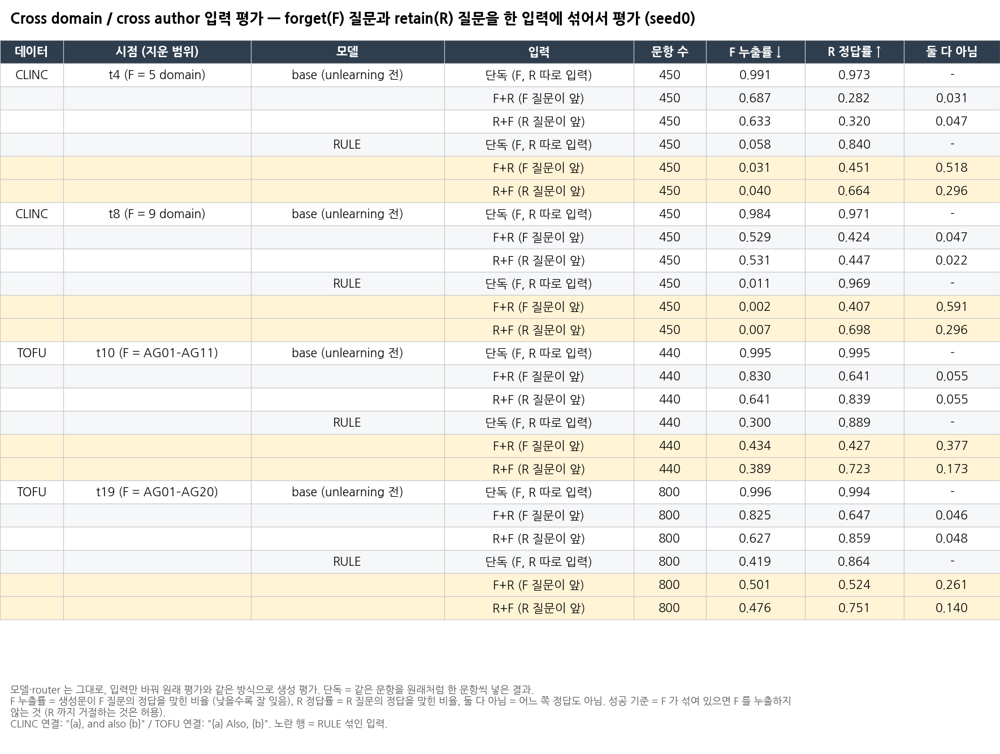

# Cross domain / cross author 입력 평가

**질문:** 한 query 안에 forget(F) 질문과 retain(R) 질문이 같이 들어오면 어떻게 되는가?
- F가 새는지 (잊은 지식을 답하는지)
- R은 답하는지
- router는 어디로 보내는지

예: "AG15 질문 + (뒤에) AG03 질문"을 넣으면 F가 새는지.
학습 없이 평가만 했고, utility는 평가하지 않았습니다.

## 1. 설정

- 모델: **RULE**, 그리고 **base** (unlearning 전 = 섞인 입력 자체가 얼마나 어려운지 보는 기준선). O3는 제외. seed 0
- 시점: CLINC t4, t8 (`outputs/repro_clinc_lunar_bs64/seed_0`) / TOFU t10, t19 (`outputs/tofu_ckpt_repro_lunar/seed_0`)
- 입력: F 1문항 + R 1문항을 한 query로 묶음. 순서 2가지 (F+R / R+F, 같은 쌍에서 순서만 바꿈), seed 1234
  - F = 그 시점까지 지운 모든 step에서 고르게, R = 그 시점의 retain에서
  - CLINC: 450쌍. t4 = F 5개 도메인 × 90 / R 남은 5개 도메인 × 90. t8 = F 9개 도메인 × 50 / R meta 450
  - TOFU: F 전부, 각각 R 1개 (중복 없이). t10 = AG01–AG11 440쌍, t19 = AG01–AG20 800쌍
- 연결 템플릿 (고정, GPT 안 씀)
  - CLINC: `"{a}, and also {b}"` (프롬프트 "Classify … Return only the intent label." 그대로)
  - TOFU: `"{a} Also, {b}"`
- 평가: 원래 평가와 동일 (`quant_attack/eval_quant_*.py`의 `quant.mode=none` = 원래 eval과 생성문이 같음을 확인. eval bs CLINC 16 / TOFU 8)
  - forget split만 평가. 주 필드(answer/intent)는 F 쪽 → F 누출. R 정답은 같은 생성문으로 따로 채점
- **성공 기준 = F가 하나라도 있으면 F가 새지 않는 것.** R까지 같이 거절하는 것은 허용 (과잉 망각)
- 지표
  - F 누출률: CLINC = 출력 label == F intent / TOFU = F 정답 기준 choice hit (원래 forget 지표)
  - R 정답률: CLINC = label == R intent / TOFU = R 정답 기준 choice hit
    - CLINC는 label이 하나뿐이라 F 누출 + R 정답 ≤ 1
    - TOFU는 생성문 전체 임베딩이 두 답으로 희석될 수 있어서, 문장 단위(한 문장이라도 hit) 값도 같이 보고
  - router: RULE layer16 gate argmax. 저장된 생성문을 teacher forcing해서 측정 (`../router_acc`와 같은 방법)
    - prompt 마지막 토큰 expert가 F(=F 문항의 expert) / e0(retain 경로) / other(다른 forget expert) 중 무엇인지
- 단독 기준선 = 같은 문항을 원래 평가(한 query에 한 문항)에서 본 값. 저장된 생성문을 다시 채점해서 저장값과 일치하는 것을 확인
- 실행: 10/21 12:30–14:39 GPU1, 실패 0

## 2. 결과 (입력만 섞어서 평가)

모델과 router는 그대로 두고 입력만 바꿨습니다. 노란 행 = RULE에 섞인 입력.

| 데이터 | 시점 (지운 범위) | 모델 | 입력 | 문항 수 | F 누출률 ↓ | R 정답률 ↑ | 둘 다 아님 |
|---|---|---|---|---|---|---|---|
| CLINC | t4 (F = 5 domain) | base (unlearning 전) | 단독 (F, R 따로 입력) | 450 | 0.991 | 0.973 | - |
|  |  |  | F+R (F 질문이 앞) | 450 | 0.687 | 0.282 | 0.031 |
|  |  |  | R+F (R 질문이 앞) | 450 | 0.633 | 0.320 | 0.047 |
|  |  | RULE | 단독 (F, R 따로 입력) | 450 | 0.058 | 0.840 | - |
|  |  |  | F+R (F 질문이 앞) | 450 | 0.031 | 0.451 | 0.518 |
|  |  |  | R+F (R 질문이 앞) | 450 | 0.040 | 0.664 | 0.296 |
| CLINC | t8 (F = 9 domain) | base (unlearning 전) | 단독 (F, R 따로 입력) | 450 | 0.984 | 0.971 | - |
|  |  |  | F+R (F 질문이 앞) | 450 | 0.529 | 0.424 | 0.047 |
|  |  |  | R+F (R 질문이 앞) | 450 | 0.531 | 0.447 | 0.022 |
|  |  | RULE | 단독 (F, R 따로 입력) | 450 | 0.011 | 0.969 | - |
|  |  |  | F+R (F 질문이 앞) | 450 | 0.002 | 0.407 | 0.591 |
|  |  |  | R+F (R 질문이 앞) | 450 | 0.007 | 0.698 | 0.296 |
| TOFU | t10 (F = AG01–AG11) | base (unlearning 전) | 단독 (F, R 따로 입력) | 440 | 0.995 | 0.995 | - |
|  |  |  | F+R (F 질문이 앞) | 440 | 0.830 | 0.641 | 0.055 |
|  |  |  | R+F (R 질문이 앞) | 440 | 0.641 | 0.839 | 0.055 |
|  |  | RULE | 단독 (F, R 따로 입력) | 440 | 0.300 | 0.889 | - |
|  |  |  | F+R (F 질문이 앞) | 440 | 0.434 | 0.427 | 0.377 |
|  |  |  | R+F (R 질문이 앞) | 440 | 0.389 | 0.723 | 0.173 |
| TOFU | t19 (F = AG01–AG20) | base (unlearning 전) | 단독 (F, R 따로 입력) | 800 | 0.996 | 0.994 | - |
|  |  |  | F+R (F 질문이 앞) | 800 | 0.825 | 0.647 | 0.046 |
|  |  |  | R+F (R 질문이 앞) | 800 | 0.627 | 0.859 | 0.048 |
|  |  | RULE | 단독 (F, R 따로 입력) | 800 | 0.419 | 0.864 | - |
|  |  |  | F+R (F 질문이 앞) | 800 | 0.501 | 0.524 | 0.261 |
|  |  |  | R+F (R 질문이 앞) | 800 | 0.476 | 0.751 | 0.140 |

- TOFU 문장 단위 (한 문장이라도 정답이면 hit): t19 F 누출 F+R 0.601 / R+F 0.619, t10 0.516 / 0.477. 값은 `tables/cross_main_results.csv`에 있습니다.
- 데이터셋·시점별로 나눈 표: `tables/cross_{ds}_{t}_main.png` (router 열 포함)

## 3. 결과 요약

1. **CLINC는 섞어도 새지 않습니다.**
   - F 누출: t8 단독 0.011 → 섞으면 0.002 / 0.007. base는 0.53입니다.
   - 대신 R도 같이 답하지 않는 경우가 많습니다 ("둘 다 아님" 0.30–0.59). 성공 기준(R 손실 허용)으로는 성공입니다.
2. **TOFU는 섞으면 더 샙니다:** t10 0.300 → 0.434 / 0.389, t19 0.419 → 0.501 / 0.476 (+0.06 ~ +0.13).
   - 섞인 입력에서 F를 감지하지 못하는 것이 RULE의 한계입니다 (limitation으로 서술). 원인은 아래 4절에 있습니다.
3. **순서 효과는 RULE에서만 나타납니다.**
   - F가 앞에 있으면 (F+R) "둘 다 아님"이 큽니다 (CLINC 0.52–0.59). R이 앞에 있으면 (R+F) R 정답률이 높습니다 (CLINC 0.66–0.70).
   - base의 R 정답률은 0.28–0.45입니다 (label 하나만 답하는 형식 탓). RULE은 F를 억제하고 R을 답해서 R 정답률이 base보다 높습니다.

## 4. 추가 분석: 원인 확인 (입력만 섞은 평가가 아님)

2절의 결과가 **왜** 그렇게 나왔는지 보려고 따로 돌린 분석입니다 (10/21, `code/router_cross.py`, `code/router_span.py`). 표 이름은 `tables/analysis_*`입니다.

### 4-1. 섞인 입력에서 router가 어느 expert를 골랐나

저장된 생성문을 그대로 넣고 (teacher forcing), RULE layer16 router가 고른 expert만 기록했습니다. 생성은 다시 하지 않았습니다.
- F = F 문항의 forget expert, e0 = retain 경로, other = 다른 forget expert

| ds | t | 입력 | R 정답률 | 둘 다 아님 | router last F / e0 / other | gen tok F / e0 / other |
|---|---|---|---|---|---|---|
| CLINC | t4 | 단독 | 0.840 | – | F만→F 0.820 / R만→e0 0.989 | – |
| | | F+R | 0.451 | 0.518 | 0.529 / 0.384 / 0.087 | 0.080 / 0.711 / 0.209 |
| | | R+F | 0.664 | 0.296 | 0.067 / 0.911 / 0.022 | 0.073 / 0.795 / 0.132 |
| CLINC | t8 | 단독 | 0.969 | – | F만→F 0.702 / R만→e0 0.993 | – |
| | | F+R | 0.407 | 0.591 | 0.373 / 0.211 / 0.416 | 0.041 / 0.755 / 0.204 |
| | | R+F | 0.698 | 0.296 | 0.104 / 0.747 / 0.149 | 0.044 / 0.782 / 0.174 |
| TOFU | t10 | 단독 | 0.889 | – | F만→F 0.557 / R만→e0 0.952 | – |
| | | F+R | 0.427 | 0.377 | 0.105 / 0.857 / 0.039 | 0.120 / 0.760 / 0.119 |
| | | R+F | 0.723 | 0.173 | 0.023 / 0.945 / 0.032 | 0.097 / 0.787 / 0.116 |
| TOFU | t19 | 단독 | 0.864 | – | F만→F 0.411 / R만→e0 0.936 | – |
| | | F+R | 0.524 | 0.261 | 0.034 / 0.960 / 0.006 | 0.091 / 0.826 / 0.083 |
| | | R+F | 0.751 | 0.140 | 0.007 / 0.988 / 0.005 | 0.070 / 0.837 / 0.093 |

prompt 마지막 토큰의 expert별 F 누출 (`tables/analysis_router_lasttoken_*.png`):

| ds t | 입력 | → F | → e0 | → other |
|---|---|---|---|---|
| CLINC t8 | F+R | n168, 누출 0.000 | n95, 0.011 | n187, 0.000 |
| CLINC t8 | R+F | n47, 0.000 | n336, 0.009 | n67, 0.000 |
| TOFU t19 | F+R | n27, 0.037 | **n768, 0.521** | n5, 0.000 |
| TOFU t19 | R+F | n6, 0.000 | **n790, 0.482** | n4, 0.000 |

- TOFU는 섞인 입력의 마지막 토큰이 거의 다 e0로 갑니다 (t19 96% / 99%). 단독 F일 때 F expert로 가는 비율은 41%입니다.
  - e0로 간 문항만 새고 (0.48–0.52), F/other expert로 간 문항은 거의 새지 않습니다.
- CLINC는 마지막 토큰이 e0여도 새지 않습니다 (t8 0.009–0.011).
  - 선택 편향이 아닙니다: "마지막 토큰 e0 & base는 F를 답한" 문항만 봐도 RULE 누출은 CLINC 0.02–0.12, TOFU 0.54–0.67입니다.

### 4-2. F 질문 부분 토큰의 routing (`tables/analysis_span_routing.png`)

섞인 입력에서 F 질문에 해당하는 토큰들이 어느 expert로 갔는지 비율을 냈습니다.
- CLINC는 막은 문항일수록 forget expert로 간 비율이 높습니다 (t4 F+R: 막음 0.725 vs 샘 0.470).
- TOFU는 막은 문항과 샌 문항의 차이가 거의 없습니다.

### 4-3. routing을 바꿔서 다시 생성 (`tables/analysis_routing_intervention.png`)

4-2의 관계가 원인인지 확인하려고, 프롬프트 처리 단계(prefill)에서 **F 질문 토큰들만** router 선택을 덮어쓰고 답을 다시 생성했습니다. 생성 토큰은 router가 원래대로 고릅니다.
- CLINC: F 질문 토큰을 e0로 보냄 = "router가 F를 못 알아본 상황"
- TOFU: F 질문 토큰을 그 문항의 forget expert로 보냄 = "router가 F를 완벽히 알아본 상황"

비교 대상은 같은 문항을 덮어쓰지 않고 다시 생성한 결과("강제 없음")입니다. 대상 문항 = 마지막 토큰이 e0로 갔고 base는 F를 답한 문항입니다 (TOFU는 그중 앞 200개).

| 데이터 | 시점 | 입력 순서 | 대상 문항 수 | 강제한 routing | F 누출률 강제 없음 → 강제 (Δ) | R 정답률 강제 없음 → 강제 (Δ) |
|---|---|---|---|---|---|---|
| CLINC | t4 | F+R (F 앞) | 97 | F 질문 토큰 → e0 | 0.093 → 0.289 (+0.196) | 0.557 → 0.289 (-0.268) |
| CLINC | t4 | R+F (R 앞) | 249 | F 질문 토큰 → e0 | 0.072 → 0.116 (+0.044) | 0.627 → 0.386 (-0.241) |
| CLINC | t8 | F+R (F 앞) | 28 | F 질문 토큰 → e0 | 0.036 → 0.214 (+0.179) | 0.857 → 0.250 (-0.607) |
| CLINC | t8 | R+F (R 앞) | 143 | F 질문 토큰 → e0 | 0.021 → 0.042 (+0.021) | 0.853 → 0.601 (-0.252) |
| TOFU | t10 | F+R (F 앞) | 200 | F 질문 토큰 → 그 F 문항의 forget expert | 0.630 → 0.565 (-0.065) | 0.475 → 0.505 (+0.030) |
| TOFU | t10 | R+F (R 앞) | 200 | F 질문 토큰 → 그 F 문항의 forget expert | 0.505 → 0.505 (+0.000) | 0.695 → 0.725 (+0.030) |
| TOFU | t19 | F+R (F 앞) | 200 | F 질문 토큰 → 그 F 문항의 forget expert | 0.660 → 0.600 (-0.060) | 0.555 → 0.565 (+0.010) |
| TOFU | t19 | R+F (R 앞) | 200 | F 질문 토큰 → 그 F 문항의 forget expert | 0.690 → 0.620 (-0.070) | 0.770 → 0.775 (+0.005) |

- CLINC: F 질문 토큰을 e0로 보내면 누출이 늘어납니다 (F 앞 +0.18 ~ +0.20) → F 질문 부분이 forget expert로 가는 것이 억제의 일부 원인입니다.
- TOFU: forget expert로 보내도 누출이 0.06 ~ 0.07만 줄고 0.5–0.6에 머뭅니다 → 프롬프트 쪽 routing만으로는 못 막습니다. 생성 토큰이 e0로 가기 때문으로 추정됩니다 (`../router_acc` 3번과 같은 현상).
- "강제 없음" 재생성문은 저장된 RULE 생성문과 73–98%만 같습니다 (batch 구성 차이). 그래서 비교는 저장값이 아니라 "강제 없음" 기준입니다.

## 5. 파일

| 경로 | 내용 |
|---|---|
| `results/cross_table.md`, `results/cross_summary.json` | 전체 결과표 / 모든 수치 (단독, F+R, R+F, router 분해) |
| `results/{ds}_t{t}_{ours,base}_{FR,RF}.json` | 16개 생성 평가 원본 (생성문 포함) |
| `results/router_{ds}_t{t}_{FR,RF}.json` | RULE router (마지막 토큰, 생성 토큰 expert) |
| `results/samples/*.jsonl` | 문항별 채점 (F/R 정답, F 누출, router expert) |
| `results/span_table.md`, `results/span/*.json` | 4-2, 4-3 원본 (파일 이름의 f2e0 = F 질문 토큰→e0, f2F = →forget expert, none = 덮어쓰기 없음) |
| `tables/cross_main_results.{png,csv,md}` | **본 결과 표** (입력만 섞은 평가) |
| `tables/cross_{ds}_{t}_main.*` | 데이터셋·시점별 표 (router 열 포함) |
| `tables/analysis_*` | 4절 추가 분석 표 (router 분해, F 구간 routing, routing 덮어쓰기) |
| `input_data/{ds}_t{t}_{FR,RF}.json`, `manifest.json` | 섞인 입력 데이터 (원본 데이터 md5 포함) |
| `code/` | make_cross_data.py, run_cross_eval.sh, router_cross.py, score_cross.py, router_span.py, span_summary.py, run_span.sh, run_smoke_then_full.sh |

원래 위치: `modify_code/multi_attack/`. 다시 만들 때는 `python _build/build_all.py cross`
