# Latency / Memory

**질문:** RULE이 base 모델에 더하는 비용(파라미터, GPU 메모리, 학습 시간, 추론 latency)은 얼마이고, O3와 full fine-tuning baseline(GA / GD / NPO+KL)과 비교하면 어떤가?
요청이 80건을 넘게 쌓여도(expert 80개 이상) 비용이 유지되는가?

## 1. 설정

- **비교군:** base(RULE에서 MoE를 뺀 모델) / RULE / O3 / GD(`ga_gd`). GA, NPO+KL은 학습만 같이 잼
- **시점:** RULE CLINC t0·t4·t8, TOFU t0·t10·t19 / O3 CLINC t0·t8, TOFU t0·t19 / GD t0 (CLINC, TOFU). seed 0
- **환경:** A100 80GB PCIe 1장 (나머지 1장은 측정 내내 비움, `results/timing/mon_*.json`의 `clean`), Xeon Gold 6338 ×2 (64 core / 128 thread), 384GB RAM, Ubuntu 22.04.5, driver 535.247.01 (CUDA 12.2)
  - GPU clock 고정 안 함 (persistence on, SM 1410MHz, 300W). 공유 컨테이너라 측정마다 load average 기록 (시간 측정 중 최대 약 6)
- **원칙:** 각 방법은 원래 평가·학습 환경과 구현 그대로
  - RULE / base / GD: lunar (torch 2.5.1+cu121, transformers 4.46.3), HF `AutoModelForCausalLM` (SDPA), bf16, greedy, KV cache, TF32 off, 원래 eval batch (CLINC 16 / TOFU 8)
  - O3: adapter가 저장된 peft 버전 그대로
    - CLINC: OOD detector = o3 env (torch 2.1.1, transformers 4.37.2, peft 0.10.0), LLM LoRA = lunar + peft 0.18.1
    - TOFU: LLM · detector 모두 o3 env. 원래 PTOFU 코드 그대로 (수정 모델, rope_scaling 검사 완화 패치 포함)
    - O3 LLM은 원래 코드의 eager attention + 7종 linear × 32 layer LoRA. bs1만 가능 (OOD weight가 batch 단위)
  - GD 학습: 원래 baseline 설정 (2 GPU DeepSpeed ZeRO-3, optimizer CPU offload, global batch 128, lr 1e-5)
- **입력:** 데이터셋마다 같은 200문항 (마지막 시점 forget 100 + retain 100, seed 1234), 모든 방법에 같은 순서
  - CLINC prompt 평균 64.4 tok, TOFU 50.3 tok
- **측정:** 모델·adapter·detector 로드와 토큰화는 제외, warm-up 2 batch, 요청마다 `cuda.synchronize`
  - **64 tok 고정** (`min_new_tokens = max_new_tokens = 64`) = 연산 비교용 (주 결과)
  - **원래 생성 설정** (max_new_tokens 512, O3는 원래 평가값 128 / TOFU 200) = 출력 길이 효과 포함 (부록)
  - TTFT = 같은 생성 안에서 첫 logits가 나온 시점 (값을 바꾸지 않는 LogitsProcessor)
  - decode ms/token = (전체 − TTFT) / (생성 step − 1)
- **메모리:** GPU = torch `max_memory_allocated` (측정 스크립트 안) + nvidia-smi peak, host = 프로세스 트리 PSS
  - **시간과 메모리는 따로 잼.** PSS를 재려고 `/proc/<pid>/smaps_rollup`을 0.5초마다 읽으면 큰 프로세스가 느려짐 (CLINC MoE 학습이 2.6배 느려진 것을 확인) → 시간 = `monitor.py --light` (nvidia-smi + loadavg만), host 메모리 = PSS 실행

## 2. 추가 파라미터

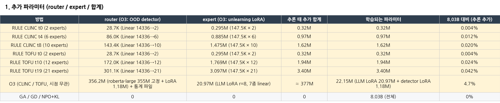

- RULE: layer16 down_proj **한 곳**에만 expert (LoRA r=8, 147,456) + router (`Linear(14336→E)`, 14,337)가 붙음. expert 하나 = 0.162M
- O3: LLM LoRA가 **32 layer × 7 linear = 224곳**에 붙음 (20.97M). router 역할인 OOD detector는 별도 roberta-large (355M, 고정) + LoRA 1.18M
- e0(retain 경로)의 LoRA는 0이지만 텐서로 저장돼 개수에 포함

## 3. 추론 latency

### 3-1. bs1, 64 tok 고정 (주 표)

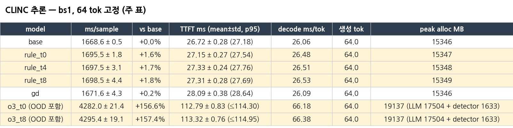
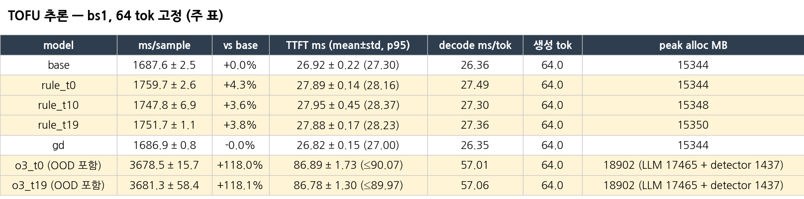

- RULE: base 대비 **+1.6 ~ +4.3%**. expert 수(2 → 21)와 거의 무관. TTFT +0.4 ~ 1.0ms, decode +0.4 ~ 1.1ms/token
- GD: base와 같음 (+0.2% / −0.0%). 구조가 같으므로 당연하지만 실측으로 확인
- O3: **+118 ~ +157%**. TTFT 87 ~ 113ms (OOD 27 ~ 45ms + LLM 59 ~ 70ms), decode 57 ~ 66ms/token (base의 2.2 ~ 2.5배)
  - O3 ms/sample · TTFT = OOD 점수 계산 + LLM 생성 (순차라 그대로 더해짐), peak = LLM + detector
  - O3 std는 요청별 (24문항 × 3회), 나머지는 3회 반복 평균 사이. O3 TTFT p95는 OOD p95 + LLM p95 (상한)
- 같은 측정을 다른 회차에 반복하면 ±1~2% 흔들림 → RULE 추가 비용은 "약 2~4%"로 쓰는 것이 안전

### 3-2. eval batch, 64 tok 고정

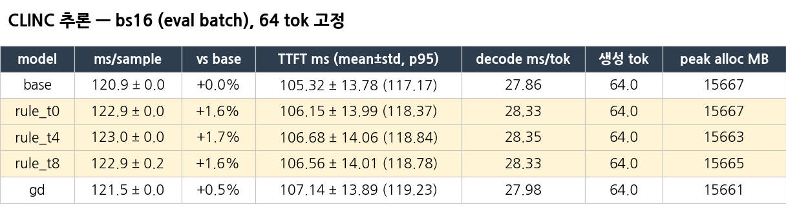
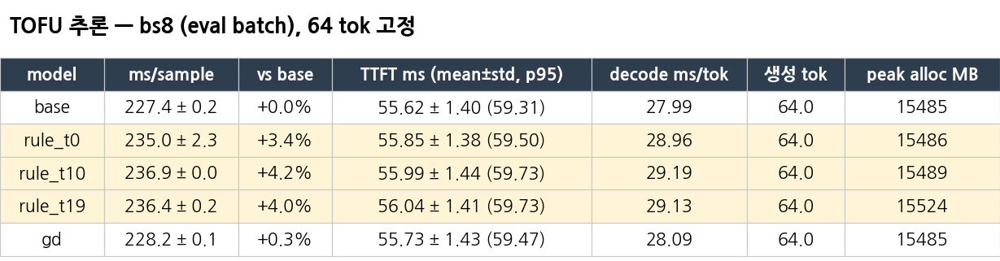

### 3-3. 원래 생성 설정 (부록)

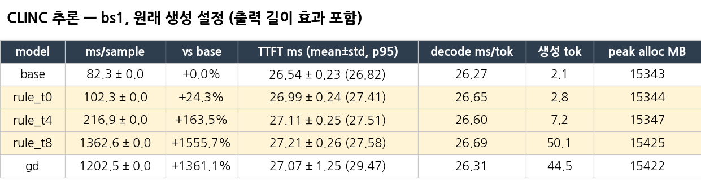
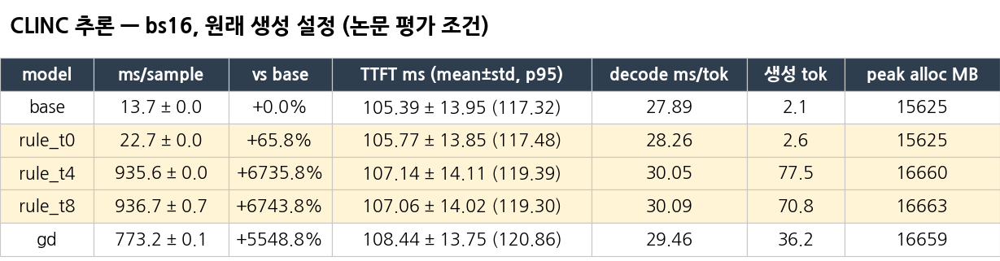
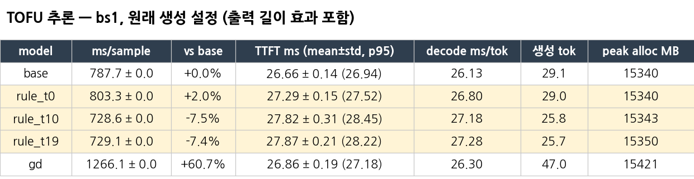
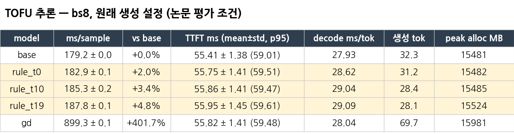

- 차이는 **출력 길이** 때문: CLINC base는 label만 (2.1 tok), RULE t4·t8은 지운 도메인 질문에 거절문 (50 ~ 78 tok) → +1,556% 같은 수치가 나옴. decode ms/token은 거의 같음
- bs1 원래 설정은 앞 24문항 1회만 → std 0.0은 반복이 없어서 생긴 값 (실제 편차 아님)

### 3-4. O3 분해 (OOD 점수 계산 + LLM)

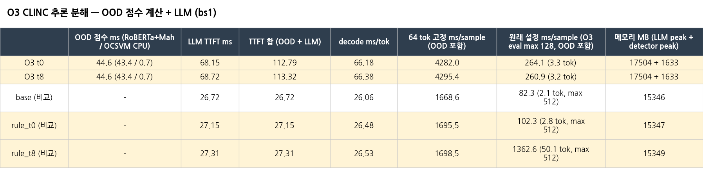
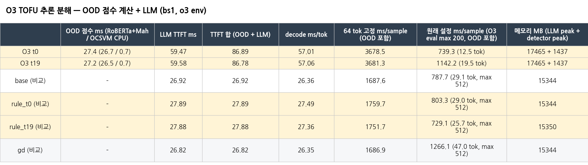

- O3 OOD 점수 계산: CLINC 44.6ms (RoBERTa+Mahalanobis 43.4 / OCSVM CPU 0.7), TOFU 27.3ms (26.6 / 0.7). TOFU는 OOD 입력이 256 tok (CLINC 512)
- O3 원래 생성 설정 (CLINC max 128, TOFU max 200)은 출력이 짧아 (3 ~ 20 tok) 원래 설정 ms/sample 차이가 64 tok 고정보다 작게 보임

## 4. Router / Expert 계산

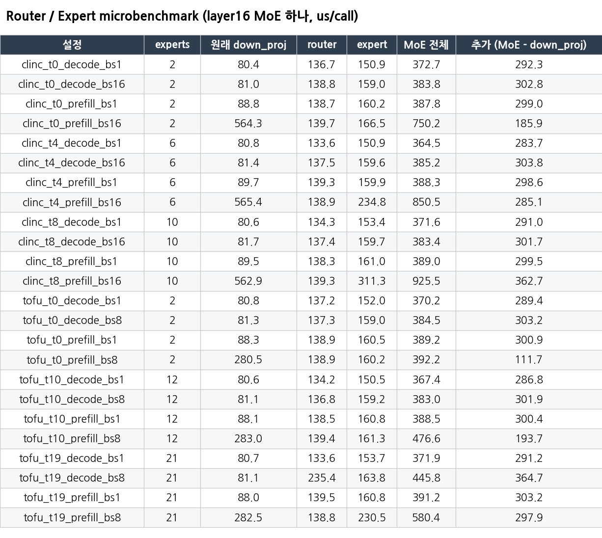

- layer16 MoE 하나만 떼서 같은 입력 크기로 500회 (warm-up 50) 반복
- MoE 한 번 호출에 추가 ≈ **0.29 ~ 0.30ms**, expert 수와 거의 무관. router ≈ 0.135ms, expert ≈ 0.155ms
  - 작은 커널을 띄우는 고정 비용이 대부분 (decode는 CPU kernel launch에 묶임)
  - batch가 큰 prefill (bs16)만 expert 수에 따라 증가 (+0.19 → +0.36ms)
- 32 layer 중 1개 layer의 down_proj에서만 일어남 → TTFT 증가분 ≈ router + expert 1회, decode는 토큰마다 1회
- RULE이 더하는 연산은 MLP의 down_proj 자리에서만 일어나고 attention은 건드리지 않음 → 추가되는 **절대 시간**은 attention 구현과 무관. 비율(%)은 분모(base 시간)에 따라 달라짐 (eager는 SDPA보다 ~13% 느려서 %는 더 작아짐)
- O3 대응 비용 (OOD 점수 계산)은 요청당 1회 27 ~ 45ms. RULE router는 토큰당 0.137ms → TTFT 기준 약 320배, 64 tok 생성 전체 (65회) 기준 약 5배

## 5. 학습

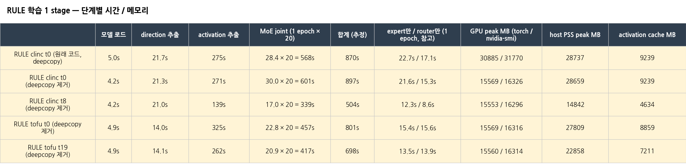
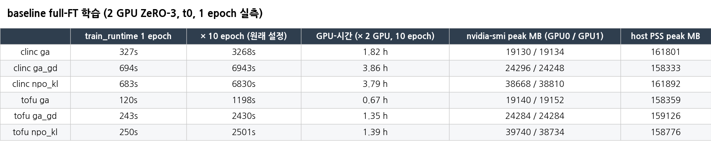
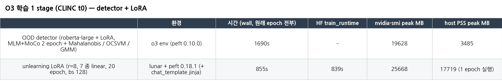

- RULE (1 GPU, 1 stage): UV direction 14 ~ 22s + activation 추출 139 ~ 325s + MoE joint (20 epoch) 339 ~ 601s = **약 8 ~ 15분**
  - MoE는 1 epoch 실측 × 20 (원래 학습 로그와 일치: CLINC t0 로그 577s vs 측정 568 ~ 601s)
  - expert와 router는 **한 루프에서 같이** 학습 (`train_moe.py mode=joint`) → joint로 보고. expert만 / router만 1 epoch (표의 참고 열, CLINC t0 21.6s / 15.3s, TOFU t19 13.5s / 13.9s 등)은 데이터 로딩·forward 같은 공통 비용이 양쪽에 들어가 더하면 joint보다 큼
  - **GPU 메모리:** 원래 코드는 학습용 8B 복사본 (`copy.deepcopy`)을 만들어 30.9GB. 이 복사본은 학습에 쓰이지 않음 (MoE는 CPU에 둔 activation으로 학습, 추출이 끝난 뒤 MoE 삽입) → 제거하면 **15.6GB**, 학습 입력 sha256 동일 (`results/timing/train_clinc_t0*.json`)
  - host 메모리 (PSS) 14.8 ~ 28.7GB, 이 중 activation cache 4.6 ~ 9.2GB (CPU)
- GD / GA / NPO+KL (2 GPU): 1 epoch 실측 × 10 epoch = GD CLINC 6,943s / TOFU 2,430s (GPU-시간 3.86h / 1.35h), GPU당 19 ~ 40GB, host PSS 158 ~ 162GB (ZeRO CPU offload)
  - 시간 = 1차 측정 (GPU 2장 idle, nvidia-smi 1초 polling만, `results/baseline_timing_v1`), host 메모리 = 2차 PSS 측정 (`results/memory/baseline`)
  - CLINC는 논문에 20 epoch로 적혀 있지만 baseline은 10 epoch로 학습 (`run_clinc_fullft.sh` 주석: 20이면 full-FT가 stage 1에서 붕괴)
- O3 (1 GPU, CLINC t0, 원래 학습 명령 그대로): detector 1,690s (o3 env, 2 epoch) + LoRA 839s (20 epoch) = **2,529s**
  - detector 시간의 대부분은 epoch마다의 OOD 평가 (retain 13,500문항 Mahalanobis, 1회 약 6.5분). epoch 학습 자체는 약 35초
  - detector 데이터 = `data/clincqa_SD_only_10` (work 1,500 → 80% = 저장 feature 1,200과 일치), `data/clincqa_RD_only_10/clincqa_not_work` (13,500)
  - LoRA는 `code/o3_lora_train_wrapper.py`로 실행: CLINC base가 transformers 5.x로 저장돼 chat template이 `chat_template.jinja`에만 있어서 tokenizer에 넣어 줌 (O3 추론 측정과 같은 방식, 그 외 원래 코드 그대로). 원래 학습 환경은 transformers 5.x였을 가능성이 큼

## 6. 요청 80건 이상 (expert 수 E 확장)

### 통합 표 (TOFU, bs1, 64 tok 고정)

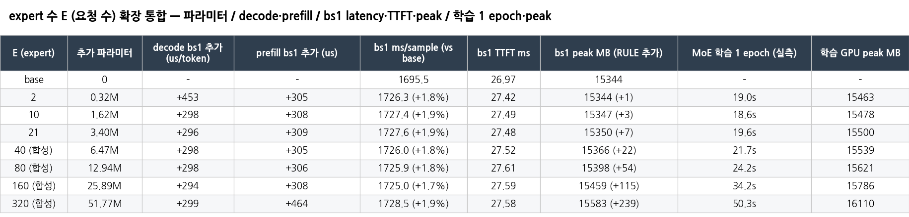

- decode / prefill 추가 = layer16 MoE microbench, bs1 ms/sample · TTFT · peak = 실제 생성 **한 회차** (base와 같은 회차, 10/23 18:09), MoE 학습 1 epoch = TOFU t19 원래 학습 경로로 1 epoch을 끝까지 돌린 실측 (10/23, 추정 없음)
- **추론은 E와 무관:** E = 2 → 320에서 bs1 +1.7 ~ +1.9%, TTFT 27.4 ~ 27.6ms, RULE 추가 메모리 +1 → +239MB
- 학습 GPU peak (실제 학습 경로, deepcopy 제거): 15,463MB (E = 2) → 15,621MB (80) → 16,110MB (320)
- **학습은 E가 커지면 늘어남:** MoE 1 epoch 19.0s (E = 2) → 24.2s (80) → 50.3s (320). 원래 학습 1 stage = 전처리 280s (E와 무관) + 20 epoch이므로 참고로 약 660s → 763s → 1,285s
  - 원인은 연산이 아니라 구현: `train_moe.py`의 `zero_expert_param_grads` / `zero_gate_row_grads`가 step마다 이전 expert의 grad를 **하나씩 반복**해서 0으로 만듦 (step당 4 × (E−1)개 작은 kernel, epoch당 3,205 step). 슬라이스 한 번 (`grad[:cur].zero_()`)으로 바꾸면 사라질 비용 (측정은 원래 코드 그대로)
  - 학습 대상 = 마지막 expert (E−1), forget label도 E−1로 맞춰 실제 E번째 요청 상황과 같게 잼. 처음에 학습 대상을 20번에 고정해 잰 값 (이 grad 0 비용이 빠짐, E = 320에서 741s)은 `results/timing/scale_train_cur20.json`에 기록만 둠
  - 전처리 (모델 로드 + direction + activation 추출, 280s)는 base 모델로 하므로 E와 무관
- E = 2의 decode bs1 +453us는 microbench 초기값 이상치 (다른 E는 모두 약 +300us)

### 상세

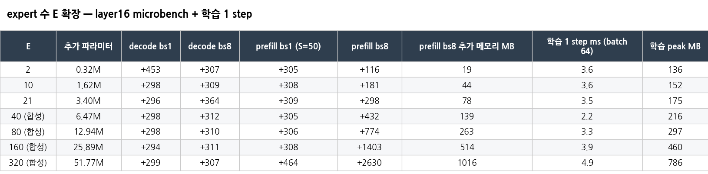
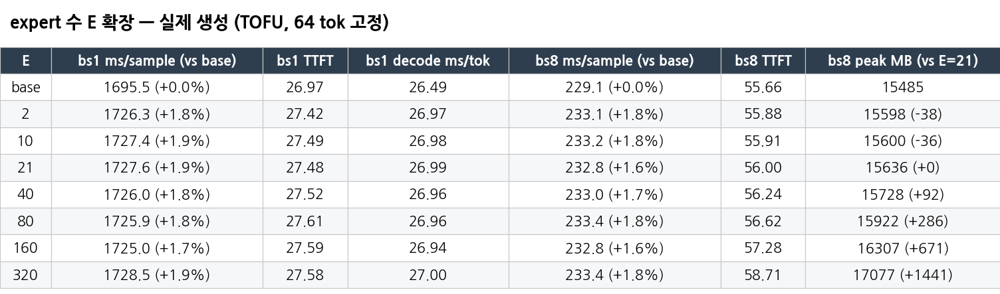

- E = 2, 10, 21: 실제 TOFU ckpt (t0, t8, t19). E ≥ 40: t19의 실제 expert 21개 + 랜덤 expert (원래 확장 함수와 같은 N(0, 0.01) 초기화)
  - 연산량은 가중치 값과 무관 (top-1이어도 모든 expert의 LoRA를 계산한 뒤 섞음, 값에 따라 갈리는 분기 없음). 출력 길이는 가중치에 좌우되므로 **64 tok 고정만** 유효
- decode: E = 320까지 MoE 추가 ≈ **0.3ms로 평평**. 실제 생성 bs1은 E와 무관하게 +0.7 ~ +1.9%
- prefill + batch: E에 비례 (`BAx` [B, S, E, 4096]을 한꺼번에 만듦). bs8에서 E = 320이면 +2.6ms, +1.0GB (TTFT 57.1 → 59.9ms, +4.8%)
- 학습 1 step microbench (batch 64, 랜덤 activation, grad 0 반복 없이): E = 320에서도 5ms 이하, 메모리 1GB 이하 (실제 학습 경로 총시간은 위 통합 표)
- 파라미터: E × 0.162M → E = 80이면 12.9M, 320이면 51.8M (O3가 추론 때 올리는 377M보다 작음, 같아지려면 E ≈ 2,330)
- 실제 생성 peak는 원래 down_proj (112MB)를 따로 들고 재서 base 대비 +112MB가 겹쳐 있음 → RULE의 실제 추가 메모리는 E = 21 대비 차이로 볼 것
- 이 측정은 **비용만** 봄. E가 클 때 router가 맞게 고르는지 (정확도)는 별도 문제

## 7. 버전 영향 (CLINC O3 LLM 환경 불확실성)

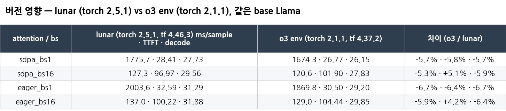

- CLINC O3 LLM LoRA는 peft 0.18.1만 기록돼 있고 torch / transformers는 모름 → peft만 맞추고 lunar에서 잼
- 같은 base Llama, 같은 prompt 토큰, 64 tok 고정, HF 기본 코드로 lunar와 o3 env를 비교: o3 env가 **5.3 ~ 6.7% 빠름** (SDPA / eager, bs1 / bs16 모두 비슷)
- 이 오차를 O3에 유리하게 최대로 적용해도 결론은 같음 (CLINC O3 +157% → 약 +139%, RULE은 +2% 이하). RULE / base / GD는 모두 같은 환경이라 서로 비교에는 영향 없음
- TOFU O3는 저장 환경 (o3 env)에서 잼 → lunar였다면 O3가 약 6% 더 느렸을 것 (O3에 유리한 쪽)

## 8. 미완료 / 주의

- O3 학습은 CLINC t0만 (TOFU O3 학습은 안 잼)
- E ≥ 40은 합성 모델 (비용만, 정확도 아님)
- bs1 원래 생성 설정은 24문항 1회 → 본문에 쓰려면 200문항 × 3회로 다시 재야 함
- GPU 1장 측정이 다른 실험과 겹친 결과는 `modify_code/latency/results/v2/concurrent/`에 따로 두고 이 폴더에는 넣지 않음

## 9. 파일 / 원래 위치

| 파일 | 내용 |
|---|---|
| `tables/*.csv`, `*.png` | 위 표 (`results/latency_table.md`에서 생성) |
| `results/latency_table.md` | 전체 표 (`modify_code/latency/summarize_latency.py`가 생성) |
| `results/timing/` | 시간 측정 원본 (monitor --light): 추론 v2, O3, 학습 profile, 버전 영향, E 확장 |
| `results/memory/` | 메모리 측정 원본 (PSS) + microbench (`microbench_moe.json`), `baseline/` = baseline host 메모리 |
| `results/baseline_timing_v1/` | baseline 학습 시간 (1차, GPU 2장 idle) |
| `results/o3_train/` | O3 학습 monitor 결과 |
| `results/existing_metrics.*` | 기존 로그에서 뽑은 값 (파라미터, 원래 학습 로그 시간, slurm baseline) |
| `code/` | 측정 코드 (measure_infer_v2.py, measure_infer_o3_llm.py, measure_o3_ood.py, measure_infer_o3_tofu.py, microbench_moe.py, scale_experts.py, profile_train.py, version_check.py, monitor.py, summarize_latency.py, run_*.sh 등) |
| 원래 위치 | `modify_code/latency/` (결과 `results/v2/`, 로그 `logs/v2/`) |
