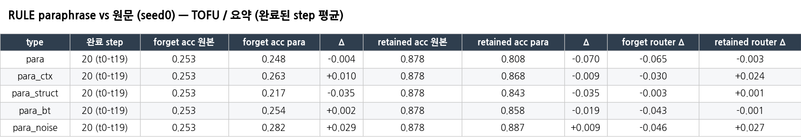
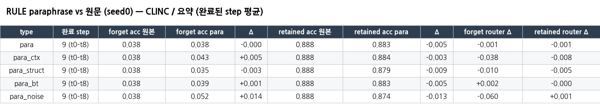
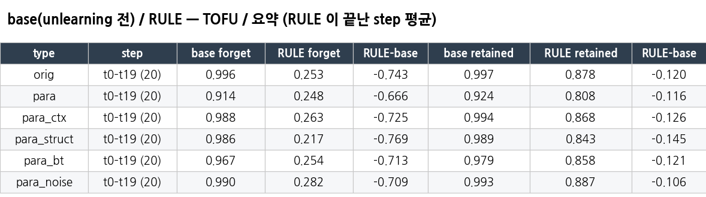
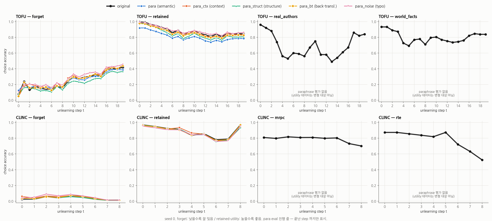

# Paraphrase 평가 (CLINC, TOFU)

**질문:** 평가 질문의 표현을 바꾸면 잊은 지식(forget)이 다시 나오는가? retain은 유지되는가?
평가 세트(SD = forget, RD = retained)만 GPT-4o로 5가지 유형으로 변형하고, 학습된 RULE ckpt(seed0)를 **원래 평가와 똑같은 파이프라인**으로 다시 평가했습니다.

## 1. 설정

- 생성: `gpt-4o-2024-11-20`, temperature 0, seed 1234, 20문항씩 묶어 JSON으로 요청 (API 비용 약 $18.3, 파일럿 포함)
  - CLINC test 4,500문장 (10 domain × 450), TOFU 3,999문항
  - 문항 풀 전체를 유형마다 **한 번만** 변형 → 원래 step 파일 구조대로 SD/RD 분할
  - intent 라벨과 정답은 GPT-4o에 주지 않음
- 유형 (원문과 똑같이 돌아온 비율 CLINC · TOFU)

| 폴더 접미사 | 내용 | 원문 동일 비율 | 예시 |
|---|---|---|---|
| `_para` | 의미를 보존한 paraphrase (표현·구조를 눈에 띄게 바꿈) | 0% · 0% | "i would like to change my insurance policy" → "i want to make changes to my insurance policy" |
| `_para_ctx` | 원래 질문은 그대로 두고, 답과 무관한 인사·사정·감사 문장을 앞뒤에 추가 (이름 언급 금지) | 0% · 0% | "Hello, I was wondering about this. Any known accolades or awards won by Tatiana Popov?" |
| `_para_struct` | 질문 ↔ 명령/평서문으로 구조 변경 | 0% · 0% | "i'll leave to lax …" → "can i leave to lax …?" |
| `_para_bt` | 역번역 (영→독→영, 이름·작품명·숫자는 번역 안 함) | 30% · 28% | "… what are Lee Joon-ki's other interests?" → "… what other interests does Lee Joon-ki have?" |
| `_para_noise` | 오타 1–3개, 구두점·대소문자 생략 (이름·숫자에는 오타 금지) | 1% · 4% | "Any knwon accolades or awards won by Tatiana Popov?" |

- 평가: seed0 step별 ckpt (CLINC t0–t8, TOFU t0–t19), `O3_RUN_MODE=eval_only`, `O3_EVAL_SPLITS=forget,retained`
  - eval batch: TOFU 8 / CLINC 16. 생성 설정은 원래와 동일
  - eval_only 동일성 확인: 원문으로 TOFU t10, CLINC t1을 다시 평가 → 생성문 100% 일치
- 비교 기준
  - RULE 원문 = 원래 seed0 결과 (`repro_tofu_lunar`, `repro_clinc_lunar_bs64`)
  - base = unlearning 전 모델에 같은 6세트(원문 + 5유형)를 1회 평가한 뒤, 각 step의 SD/RD 문항으로 재분할
- **완료: 145/145** (CLINC 5유형 × 9 step + TOFU 5유형 × 20 step) + base 12세트

## 2. 결과 요약 (step 평균, choice_accuracy)

### RULE: 원문 vs paraphrase

| ds | type | forget 원문 | forget para | Δ | retained 원문 | retained para | Δ | forget router Δ | retained router Δ |
|---|---|---|---|---|---|---|---|---|---|
| TOFU (t0–t19) | para | 0.253 | 0.248 | -0.004 | 0.878 | 0.808 | -0.070 | -0.065 | -0.003 |
| | para_ctx | 0.253 | 0.263 | +0.010 | 0.878 | 0.868 | -0.009 | -0.030 | +0.024 |
| | para_struct | 0.253 | 0.217 | -0.035 | 0.878 | 0.843 | -0.035 | -0.003 | +0.001 |
| | para_bt | 0.253 | 0.254 | +0.002 | 0.878 | 0.858 | -0.019 | -0.043 | -0.001 |
| | para_noise | 0.253 | 0.282 | **+0.029** | 0.878 | 0.887 | +0.009 | -0.046 | +0.027 |
| CLINC (t0–t8) | para | 0.038 | 0.038 | -0.000 | 0.888 | 0.883 | -0.005 | -0.001 | -0.001 |
| | para_ctx | 0.038 | 0.043 | +0.005 | 0.888 | 0.884 | -0.003 | -0.038 | -0.008 |
| | para_struct | 0.038 | 0.035 | -0.003 | 0.888 | 0.879 | -0.009 | -0.010 | -0.005 |
| | para_bt | 0.038 | 0.039 | +0.001 | 0.888 | 0.883 | -0.005 | +0.002 | -0.000 |
| | para_noise | 0.038 | 0.052 | **+0.014** | 0.888 | 0.874 | -0.013 | -0.060 | +0.001 |

### base(unlearning 전) vs RULE — 질문 자체 난이도 분리

| ds | type | base forget | RULE forget | RULE−base | base retained | RULE retained | RULE−base |
|---|---|---|---|---|---|---|---|
| TOFU | orig | 0.996 | 0.253 | -0.743 | 0.997 | 0.878 | -0.120 |
| | para | 0.914 | 0.248 | -0.666 | 0.924 | 0.808 | -0.116 |
| | para_ctx | 0.988 | 0.263 | -0.725 | 0.994 | 0.868 | -0.126 |
| | para_struct | 0.986 | 0.217 | -0.769 | 0.989 | 0.843 | -0.145 |
| | para_bt | 0.967 | 0.254 | -0.713 | 0.979 | 0.858 | -0.121 |
| | para_noise | 0.990 | 0.282 | -0.709 | 0.993 | 0.887 | -0.106 |
| CLINC | orig | 0.975 | 0.038 | -0.937 | 0.971 | 0.888 | -0.084 |
| | para | 0.976 | 0.038 | -0.938 | 0.969 | 0.883 | -0.087 |
| | para_ctx | 0.973 | 0.043 | -0.930 | 0.966 | 0.884 | -0.081 |
| | para_struct | 0.976 | 0.035 | -0.941 | 0.962 | 0.879 | -0.083 |
| | para_bt | 0.973 | 0.039 | -0.934 | 0.965 | 0.883 | -0.082 |
| | para_noise | 0.956 | 0.052 | -0.904 | 0.954 | 0.874 | -0.080 |

step별 그래프 (RULE, 원문 vs 5유형): 

## 3. 분석

1. **paraphrase로 잊은 지식이 돌아오지 않습니다.** forget 변화는 step 평균 TOFU −0.035 ~ +0.029, CLINC −0.003 ~ +0.014입니다.
   - 의미 보존(para), 역번역(bt), 문맥 추가(ctx)는 사실상 0입니다.
   - 문장 구조 변경(struct)은 오히려 forget이 더 낮습니다 (TOFU −0.035).
2. **가장 큰 증가는 표면 잡음(para_noise)입니다:** TOFU +0.029, CLINC +0.014.
   - CLINC는 앞 step에 몰려 있습니다 (t0–t4 +0.016 ~ +0.030). t7–t8은 ±0.001입니다.
   - 같은 유형에서 forget router acc가 −0.046 / −0.060 떨어집니다 → 오타 때문에 일부 문항이 forget expert로 가지 않아서 생기는 누출입니다.
   - 다만 base도 noise에서 0.956으로 조금 떨어지고, 증가 폭은 원래 forget 수준(TOFU 0.25)에 비해 작습니다.
3. **TOFU para의 retained 하락 (−0.070)은 unlearning 탓이 아니라 질문이 어려워진 탓입니다.**
   - base도 같은 세트에서 0.997 → 0.924 (−0.073) 떨어집니다.
   - RULE−base 차이는 원문 −0.120 vs para −0.116으로 같습니다.
   - t0(아직 1개만 지운 시점)에서도 이미 −0.075입니다 → 질문 난이도 효과입니다.
4. **RULE−base 차이 (forget 억제량)는 유형과 무관하게 유지됩니다:** CLINC −0.90 ~ −0.94, TOFU −0.67 ~ −0.77.
   - TOFU para에서 −0.666으로 작아 보이는 것도 base forget 자체가 0.914로 낮아서입니다. RULE forget은 0.248로 원문 0.253과 같습니다.
5. router: TOFU para는 forget router가 −0.065 떨어지는데도 forget acc는 그대로입니다.
   - 이 router 값은 결과 json의 `router_accuracy`이고, padding 문제가 있습니다 (`../router_acc` 참고).

## 4. 파일

| 경로 | 내용 |
|---|---|
| `all_metrics.{csv,json}` | 모든 run (RULE 원문 + 5유형 × step, base 6세트)의 forget/retained 지표 (choice_accuracy, router_accuracy, loss, rouge 등) |
| `results/para_eval/{tofu,clinc}_{type}/…/t*/forget_*.json` | 145개 평가 원본 (생성문 포함) |
| `results/para_eval/base/{ds}_{orig,para*}.json` | base 모델 평가 원본 (전체 풀) |
| `results/compare_para_eval.{md,csv}` | RULE 원문 vs paraphrase, step별 acc/router + Δ |
| `results/base_para_steps.{md,csv}` | base vs RULE step별 |
| `results/para_eval_steps.png` | step별 그래프 |
| `tables/*.csv, *.png` | 위 md의 모든 표 (요약, forget/retained acc, router, base/RULE step별) |
| `paraphrase_data/maps/{ds}_{type}.json` | 원문 → 변형문 매핑 전부 (`*_bt_de.json` = 역번역 중간 독일어) |
| `paraphrase_data/gen_logs/` | GPT-4o 생성 로그 (요청 수, 토큰, 비용, 강제/미변경 문항, 파일럿) |
| `code/` | make_para.py (생성), run_para_eval.sh / para_eval_supervisor_v2.sh / run_base_para_eval.sh (평가), compare_para_eval.py / base_para_steps.py / plot_para_eval.py (요약) |

변형된 데이터셋 폴더: `ScienceQA_expriment/data_new/{clincqa_SD_10,clincqa_RD_10,ptofu_SD,ptofu_RD}_{para,para_ctx,para_struct,para_bt,para_noise}`.
원본 결과 위치: `modify_code/run_results/eval_basemoe_error/llama3.1-8b-instruct/para_eval/`. 다시 만들 때는 `python _build/build_all.py para`
