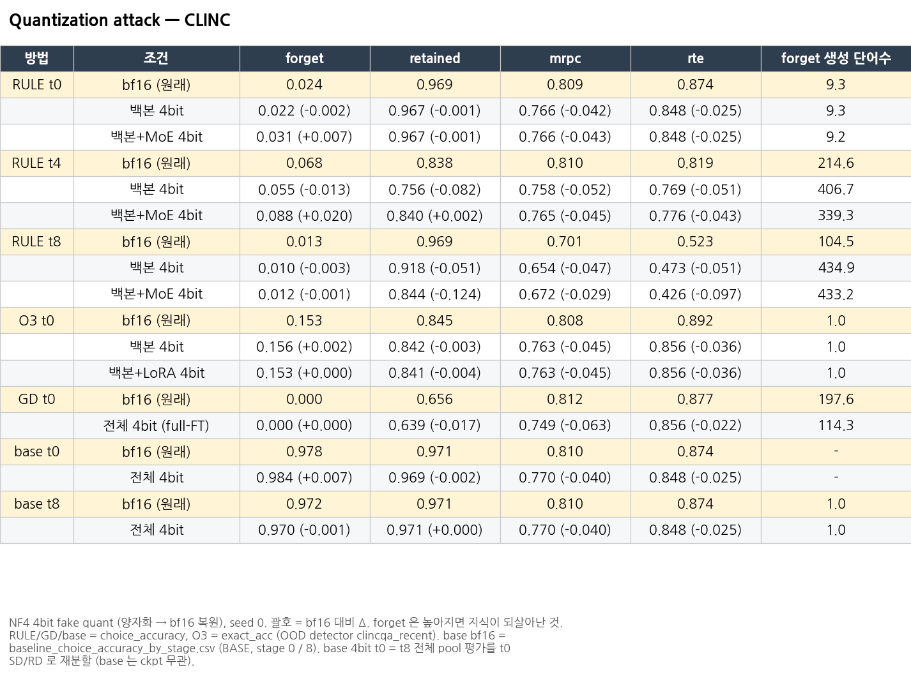
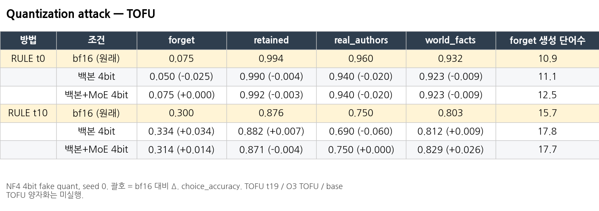

# Quantization attack

**질문:** unlearning된 모델을 4bit로 양자화하면 잊은 지식이 다시 나오는가?
Zhang et al. 2024, *Does your LLM truly unlearn? An embarrassingly simple approach to recover unlearned knowledge* (arXiv:2410.16454)의 공격입니다.
RULE은 forget을 별도 MoE(LoRA expert + router)가 담당하므로, 백본만 양자화했을 때와 MoE까지 양자화했을 때를 나눠 봤습니다.

## 1. 설정

- 양자화: **NF4 4bit fake quant** (bnb와 같은 규칙으로 양자화한 뒤 bf16으로 복원, block 64, double quant). `code/fake_quant.py`
  - **백본 4bit** = 32개 layer의 백본 Linear 224개 (q, k, v, o, gate, up, down). layer16 MoE 안의 백본 사본(`.linear`)도 포함
  - **백본+MoE 4bit** (RULE) = 위에 더해 MoE의 lora_A/B와 gate까지
  - **백본+LoRA 4bit** (O3) = 위에 더해 O3 LoRA 448개 텐서
  - embedding / lm_head / LayerNorm / bias는 bnb 기본처럼 제외. GD는 full-FT라서 "전체 4bit"가 백본 4bit와 같음
- 모델: seed 0
  - RULE: CLINC t0, t4, t8 (`outputs/repro_clinc_lunar_bs64`), TOFU t0, t10 (`outputs/tofu_ckpt_repro_lunar`)
  - O3: CLINC t0 (`unlearn_recent_o3`, OOD detector `ood_checkpoints_clincqa_recent`)
  - GD: CLINC t0 (`unlearning_baseline_new/outputs/clincqa_fullft/ga_gd`)
  - base: unlearning 전 모델
- 평가: 원래 평가 경로 그대로 (eval bs CLINC 16 / TOFU 8, GD는 원래 baseline 평가와 같은 bs 8)
  - 지표: RULE/GD/base = choice_accuracy, O3 = exact_acc (O3 원래 평가 스크립트의 채점)
  - `quant.mode=none`으로 원래 결과가 재현되는지 smoke 확인 (`results/quant_attack_results/*_smoke/`)
- 왜 CLINC t0인가: O3는 bf16에서 이미 t1부터 forget이 다시 올라갑니다 (아래 표). 그래서 O3가 "잊은 상태"인 t0에서 비교했습니다. RULE은 t4(중간 시점, 10/23 추가)와 t8도 같이 제시해 시점에 따라 결과가 바뀌지 않는다는 것을 보였습니다.

## 2. 결과

### CLINC

| 방법 | 조건 | forget | retained | mrpc | rte | forget 생성 단어수 |
|---|---|---|---|---|---|---|
| RULE t0 | bf16 (원래) | 0.024 | 0.969 | 0.809 | 0.874 | 9.3 |
|  | 백본 4bit | 0.022 (-0.002) | 0.967 (-0.001) | 0.766 (-0.042) | 0.848 (-0.025) | 9.3 |
|  | 백본+MoE 4bit | 0.031 (+0.007) | 0.967 (-0.001) | 0.766 (-0.043) | 0.848 (-0.025) | 9.2 |
| RULE t4 | bf16 (원래) | 0.068 | 0.838 | 0.810 | 0.819 | 214.6 |
|  | 백본 4bit | 0.055 (-0.013) | 0.756 (-0.082) | 0.758 (-0.052) | 0.769 (-0.051) | 406.7 |
|  | 백본+MoE 4bit | 0.088 (+0.020) | 0.840 (+0.002) | 0.765 (-0.045) | 0.776 (-0.043) | 339.3 |
| RULE t8 | bf16 (원래) | 0.013 | 0.969 | 0.701 | 0.523 | 104.5 |
|  | 백본 4bit | 0.010 (-0.003) | 0.918 (-0.051) | 0.654 (-0.047) | 0.473 (-0.051) | 434.9 |
|  | 백본+MoE 4bit | 0.012 (-0.001) | 0.844 (-0.124) | 0.672 (-0.029) | 0.426 (-0.097) | 433.2 |
| O3 t0 | bf16 (원래) | 0.153 | 0.845 | 0.808 | 0.892 | 1.0 |
|  | 백본 4bit | 0.156 (+0.002) | 0.842 (-0.003) | 0.763 (-0.045) | 0.856 (-0.036) | 1.0 |
|  | 백본+LoRA 4bit | 0.153 (+0.000) | 0.841 (-0.004) | 0.763 (-0.045) | 0.856 (-0.036) | 1.0 |
| GD t0 | bf16 (원래) | 0.000 | 0.656 | 0.812 | 0.877 | 197.6 |
|  | 전체 4bit (full-FT) | 0.000 (+0.000) | 0.639 (-0.017) | 0.749 (-0.063) | 0.856 (-0.022) | 114.3 |
| base t0 | bf16 (원래) | 0.978 | 0.971 | 0.810 | 0.874 | - |
|  | 전체 4bit | 0.984 (+0.007) | 0.969 (-0.002) | 0.770 (-0.040) | 0.848 (-0.025) | - |
| base t8 | bf16 (원래) | 0.972 | 0.971 | 0.810 | 0.874 | 1.0 |
|  | 전체 4bit | 0.970 (-0.001) | 0.971 (+0.000) | 0.770 (-0.040) | 0.848 (-0.025) | 1.0 |

### TOFU (RULE)

| 방법 | 조건 | forget | retained | real_authors | world_facts | forget 생성 단어수 |
|---|---|---|---|---|---|---|
| RULE t0 | bf16 (원래) | 0.075 | 0.994 | 0.960 | 0.932 | 10.9 |
|  | 백본 4bit | 0.050 (-0.025) | 0.990 (-0.004) | 0.940 (-0.020) | 0.923 (-0.009) | 11.1 |
|  | 백본+MoE 4bit | 0.075 (+0.000) | 0.992 (-0.003) | 0.940 (-0.020) | 0.923 (-0.009) | 12.5 |
| RULE t10 | bf16 (원래) | 0.300 | 0.876 | 0.750 | 0.803 | 15.7 |
|  | 백본 4bit | 0.334 (+0.034) | 0.882 (+0.007) | 0.690 (-0.060) | 0.812 (+0.009) | 17.8 |
|  | 백본+MoE 4bit | 0.314 (+0.014) | 0.871 (-0.004) | 0.750 (+0.000) | 0.829 (+0.026) | 17.7 |

### O3 vs RULE, CLINC bf16 step별 (t0를 고른 이유)

| step | O3 forget | O3 retained | RULE forget | RULE retained |
|---|---|---|---|---|
| t0_work | 0.153 | 0.845 | 0.024 | 0.969 |
| t1_travel | 0.502 | 0.731 | 0.027 | 0.949 |
| t2_home | 0.682 | 0.763 | 0.059 | 0.923 |
| t3_banking | 0.713 | 0.809 | 0.043 | 0.913 |
| t4_credit_cards | 0.809 | 0.904 | 0.068 | 0.838 |
| t5–t8 | 0.832–0.847 | 0.636–0.854 | 0.013–0.060 | 0.781–0.969 |

전체 (mrpc/rte 포함): `tables/o3_vs_rule_clinc_bf16_steps.{csv,png}`

## 3. 분석

1. **어떤 방법, 시점, 양자화 범위에서도 forget은 되살아나지 않습니다.**
   - forget 변화는 ±0.03 이내입니다. 최대는 TOFU RULE t10 백본 4bit +0.034로, 440문항 중 약 15문항입니다.
   - 백본+MoE에서는 +0.014입니다. CLINC t4는 백본 4bit −0.013, 백본+MoE 4bit +0.020 (450 × 5 = 2,250문항 중 약 45문항)입니다.
   - 양자화로 떨어지는 것은 주로 utility(mrpc/rte −0.02 ~ −0.06)와, RULE CLINC t8의 retained(−0.05 / −0.12), t4 백본 4bit의 retained(−0.082)입니다.
2. **RULE에 양자화 공격이 통하지 않는 이유 (구조):** RULE은 백본을 바꾸지 않고 forget을 MoE expert와 router로 처리합니다.
   - 그래서 "양자화로 작은 가중치 변화가 지워져 원래 모델로 돌아간다"는 공격 가정이 처음부터 해당되지 않습니다.
   - MoE까지 4bit로 만들어도 (lora/gate rel L2 오차 약 0.095) routing과 expert 출력이 유지됩니다.
3. **GD도 이 설정에서는 되살아나지 않습니다** (forget 0.000 → 0.000). 그래서 논문처럼 "baseline은 살아나고 RULE은 안 살아난다"는 대비는 이 결과로는 만들 수 없습니다.
   - CPU 가중치 분석 (`tables/gd_t0_weight_delta_nf4.png`): GD의 ΔW는 ‖ΔW‖/‖W‖ = 0.002로 NF4 눈금의 0.1% 수준입니다. 그래서 99.3%의 원소가 base와 같은 NF4 값으로 양자화됩니다.
   - 그런데 남은 0.7% 원소가 다른 눈금으로 넘어가면서, 양자화 뒤의 차이가 오히려 ΔW보다 큽니다 (keep_ratio 8.7). 즉 "작은 ΔW가 양자화로 사라진다"는 논문의 가정이 이 GD 체크포인트에는 맞지 않습니다.
   - GD t0의 bf16 retained가 0.656으로 원래 많이 망가져 있는 것도 참고하세요.
4. **O3도 forget 변화가 없습니다** (0.153 → 0.156 / 0.153). O3는 OOD detector가 입력마다 LoRA 가중치를 조절하는 구조라서, 백본 양자화의 영향이 작습니다.
5. **RULE CLINC t4·t8에서는 양자화 후 생성이 길어집니다** (forget 생성 단어 수 t8 105 → 435, t4 215 → 407 / 339, 평가 시간 약 6배). 라벨만 답해야 하는데 긴 문장이 나오면서 retained와 utility가 떨어집니다. t0에서는 이런 현상이 없습니다 (9.3 → 9.2).

## 4. 실행 안 됐거나 쓰지 않은 것 (기록)

| 항목 | 상태 |
|---|---|
| RULE TOFU t19 백본/전체 4bit | 10/21 07:49 CLINC t0으로 우선순위를 바꾸면서 실행 중 중단 → 결과 없음 (`results/quant_attack_results/tofu_t19_fake/` 비어 있음, smoke만 있음) |
| O3 TOFU 양자화 | 코드만 있음 (`code/eval_quant_o3_tofu.py`), 미실행 |
| O3 CLINC t8 (n50, OOD `_recent` / `_9`) | O3가 t8에서 이미 forget 0.84라서 중단. stderr 로그만 있음 |
| `o3_test_t0_n20`, `o3_test9_t0_n20` | O3 재현 확인용 20문항 (OOD `_recent` 20/20, `_9` 2/20 → `_recent` 채택) |
| GD t0 3bit | 시도했다가 중단, 결과 없음 (`logs/t0_gd_3bit.log`는 원래 폴더에 있음) |
| **[legacy] `clinc_t8/`** (10/16 SLURM) | 예전 bs1024 ckpt + bnb 실제 4bit + eval bs8 결과. 논문 설정(bs64)이 아니라서 본문에는 쓰지 않음. 기록용으로 `tables/legacy_clinc_t8_bs1024.{csv,png}`에 정리 (GA, NPO+KL 4bit는 forget 0 / retained 0으로 붕괴) |

## 5. 파일

| 경로 | 내용 |
|---|---|
| `quant_summary.json` | 위 표의 모든 값 (split별 acc, router acc, n, 생성 단어수, O3 contains_acc, ood_weight 평균) |
| `tables/quant_{clinc,tofu}.{csv,png}` | 본 결과 표 |
| `tables/o3_vs_rule_clinc_bf16_steps.*`, `tables/legacy_clinc_t8_bs1024.*`, `tables/gd_t0_weight_delta_nf4.*` | 보조 표 |
| `tables/all_tables.md` | 위 표 전부를 markdown으로 |
| `results/quant_attack_results/` | 원본 결과 전부 (`quant_attack/results/` 복사, 생성문 포함): `clinc_t0_bs64_fake`, `clinc_t4_bs64_fake` (10/23, smoke 재현 OK), `clinc_t8_bs64_fake`, `o3_clinc_t0_oodrecent` (split별 json + stderr), `clinc_t0_gd_bs8_fake`, `tofu_t0_fake`, `tofu_t10_fake`, smoke, legacy `clinc_t8`, `weight_delta_gd_t0.json`, 예전 `quant_table.md` (t8/t19 계획 당시, 지금은 쓰지 않음) |
| `code/` | fake_quant.py, eval_quant_{clinc,tofu,o3_clinc,o3_tofu}.py, run_quant_*.sh (t4 = `run_quant_t4_rule.sh`), weight_delta_nf4.py |

bf16 기준값 출처
- RULE = `run_results/.../repro_{clinc_lunar_bs64,tofu_lunar}` seed0
- O3 = `unlearning_o3/unlearn_recent_o3/SCALE_0.1_seed_0_…/test_seed0_{domain}_{split}.json`
- GD = 같은 스크립트의 `mode=none` 결과
- base bf16 = `unlearning_baseline_new/diagnostrics_clinc/baseline_choice_accuracy_by_stage.csv`의 BASE 행 (stage 0 = t0, stage 8 = t8). 원본은 `base_eval/.../base_units_clinc.json`, 모델 `O3_LLAMA31_ClincQA`, bf16, eval bs 8. 사본: `results/base_choice_accuracy_by_stage_clinc.csv`
- base 4bit = `clinc_t8_bs64_fake/base_backbone.json`. t0는 t8 전체 풀 평가를 t0 SD/RD로 재분할 (base는 ckpt와 무관)

다시 만들 때는 `python _build/build_all.py quant`
