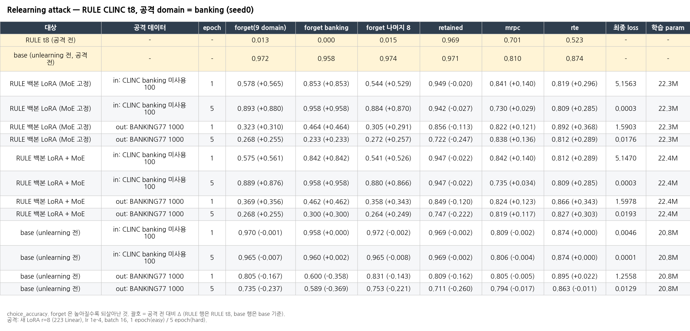
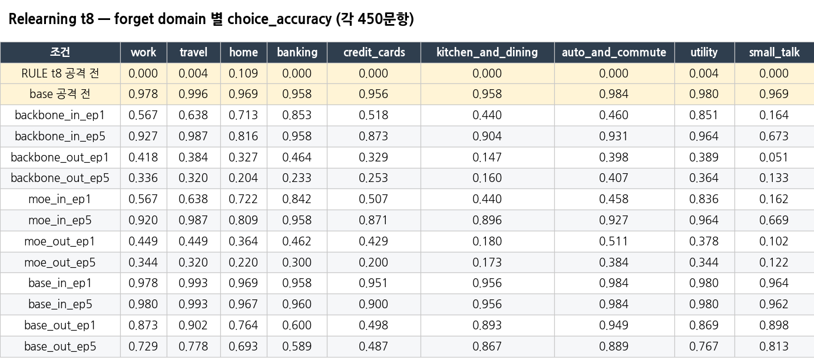
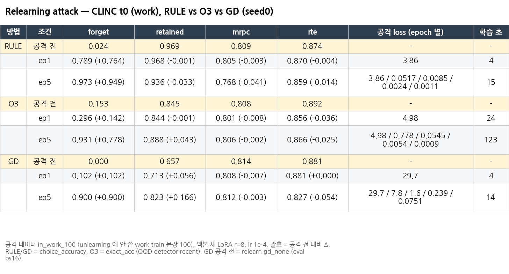

# Relearning attack (targeted relearning)

**질문:** 잊은 domain과 가까운 소량의 데이터로 공개 모델을 다시 fine-tuning하면, 잊은 지식이 얼마나 돌아오는가?
Hu et al. 2024, *Jogging the memory of unlearned models through targeted relearning attacks* (ICML 2024 Workshop)의 설정을 따랐습니다. O3 논문 F.9 (OpenbookQA로 ScienceQA를 재학습)와 같은 종류의 실험입니다.

## 1. 설정

- 공격: 새 LoRA (r=8, Linear 223개)로 fine-tuning한 뒤 merge하고, 원래 평가 경로로 다시 평가
  - lr 1e-4, batch 16 (micro 8 × accum 2)
  - **easy = 1 epoch / hard = 5 epoch**
  - `code/relearn_clinc.py`, `code/attack_lora.py`
- 공격 대상 (`attack.target`)
  - `backbone` = RULE의 백본 Linear에만 새 LoRA. MoE(expert/router)는 배포된 그대로 고정
  - `moe` = backbone + RULE MoE의 lora_A / lora_B / gate도 학습
    - top-1 hard routing이라 gate gradient가 거의 0입니다 (gate_grad_norm 평균 약 0.0016)
  - `base` = unlearning 전 모델에 같은 공격 → 공격 데이터가 줄 수 있는 효과의 기준선
- 공격 데이터 (`attack_data/`)
  - **in** = CLINC train 중 unlearning에 쓰지 않은 문장 100개. 같은 domain이고, test와 겹치지 않음
  - **out** = BANKING77 문장 1,000개. 은행 관련이지만 라벨 체계가 CLINC와 다름 → "은행 관련 지식만" 다시 주는 공격
- 실험 A: **RULE CLINC t8** (9개 domain을 다 지운 시점), 공격 domain = banking. backbone / moe / base × in / out × ep1 / ep5 = 12 run. 10/21 14:53–17:20 완료
- 실험 B: **CLINC t0 (work)**, RULE vs O3 vs GD. 공격 데이터 `in_work_100`, 백본 공격 LoRA. 10/22 00:41–02:02 완료
- 평가: forget (지금까지 지운 domain 전체 SD), retained, mrpc, rte
  - RULE/GD/base = choice_accuracy, O3 = exact_acc (OOD detector `_recent`). eval bs 16

## 2. 실험 A — RULE CLINC t8, banking 공격

| 대상 | 공격 데이터 | epoch | forget(9 domain) | forget banking | forget 나머지 8 | retained | mrpc | rte |
|---|---|---|---|---|---|---|---|---|
| **RULE t8 (공격 전)** | - | - | 0.013 | 0.000 | 0.015 | 0.969 | 0.701 | 0.523 |
| **base (공격 전)** | - | - | 0.972 | 0.958 | 0.974 | 0.971 | 0.810 | 0.874 |
| RULE 백본 LoRA | in | 1 | 0.578 | 0.853 | 0.544 | 0.949 | 0.841 | 0.819 |
| RULE 백본 LoRA | in | 5 | **0.893** | **0.958** | 0.884 | 0.942 | 0.730 | 0.809 |
| RULE 백본 LoRA | out | 1 | 0.323 | 0.464 | 0.305 | 0.856 | 0.822 | 0.892 |
| RULE 백본 LoRA | out | 5 | 0.268 | 0.233 | 0.272 | 0.722 | 0.838 | 0.812 |
| RULE 백본+MoE | in | 1 | 0.575 | 0.842 | 0.541 | 0.947 | 0.842 | 0.812 |
| RULE 백본+MoE | in | 5 | **0.889** | **0.958** | 0.880 | 0.947 | 0.735 | 0.809 |
| RULE 백본+MoE | out | 1 | 0.369 | 0.462 | 0.358 | 0.849 | 0.824 | 0.866 |
| RULE 백본+MoE | out | 5 | 0.268 | 0.300 | 0.264 | 0.747 | 0.819 | 0.827 |
| base | in | 1 | 0.970 | 0.958 | 0.972 | 0.969 | 0.809 | 0.874 |
| base | in | 5 | 0.965 | 0.960 | 0.965 | 0.969 | 0.806 | 0.874 |
| base | out | 1 | 0.805 | 0.600 | 0.831 | 0.809 | 0.805 | 0.895 |
| base | out | 5 | 0.735 | 0.589 | 0.753 | 0.711 | 0.794 | 0.863 |

domain별 forget: 

## 3. 실험 B — CLINC t0 (work), RULE vs O3 vs GD

(아래 표는 `_build/build_all.py relearn`을 실행할 때 `tables/relearn_work_t0_rule_o3_gd.csv`에서 그대로 옮긴 값입니다. GD 공격 전 = 같은 스크립트로 평가한 `gd_none` (eval bs16).)

<!-- WORK_T0_TABLE -->
| 방법 | 조건 | forget | retained | mrpc | rte | 공격 loss (epoch 별) | 학습 초 |
|---|---|---|---|---|---|---|---|
| RULE | 공격 전 | 0.024 | 0.969 | 0.809 | 0.874 | - | - |
|  | ep1 | 0.789 (+0.764) | 0.968 (-0.001) | 0.805 (-0.003) | 0.870 (-0.004) | 3.86 | 4 |
|  | ep5 | 0.973 (+0.949) | 0.936 (-0.033) | 0.768 (-0.041) | 0.859 (-0.014) | 3.86 / 0.0517 / 0.0085 / 0.0024 / 0.0011 | 15 |
| O3 | 공격 전 | 0.153 | 0.845 | 0.808 | 0.892 | - | - |
|  | ep1 | 0.296 (+0.142) | 0.844 (-0.001) | 0.801 (-0.008) | 0.856 (-0.036) | 4.98 | 24 |
|  | ep5 | 0.931 (+0.778) | 0.888 (+0.043) | 0.806 (-0.002) | 0.866 (-0.025) | 4.98 / 0.778 / 0.0545 / 0.0054 / 0.0009 | 123 |
| GD | 공격 전 | 0.000 | 0.657 | 0.814 | 0.881 | - | - |
|  | ep1 | 0.102 (+0.102) | 0.713 (+0.056) | 0.808 (-0.007) | 0.881 (+0.000) | 29.7 | 4 |
|  | ep5 | 0.900 (+0.900) | 0.823 (+0.166) | 0.812 (-0.003) | 0.827 (-0.054) | 29.7 / 7.8 / 1.6 / 0.239 / 0.0751 | 14 |
<!-- /WORK_T0_TABLE -->

## 4. 분석

1. **RULE은 targeted relearning에 강하지 않습니다.**
   - in-domain 100문장, 5 epoch이면 banking forget이 0.000 → 0.958로, base(0.958)와 같은 수준까지 완전히 돌아옵니다.
   - 1 epoch만으로도 0.853입니다.
   - 공격하지 않은 나머지 8개 domain도 0.015 → 0.884로 함께 돌아옵니다. 즉 한 domain 데이터로 재학습하면 다른 domain의 unlearning까지 풀립니다.
2. **MoE를 고정하든 같이 학습하든 결과가 같습니다** (in ep5: 0.893 vs 0.889).
   - 공격은 MoE를 우회해 백본 LoRA만으로 성공합니다.
   - router는 공격 뒤에도 forget 입력을 forget expert로 보냅니다. forget router_accuracy는 공격 전 0.681에서 공격 뒤 0.63–0.89로, 오히려 비슷하거나 높습니다 (in ep5 0.885 / 0.884). 그런데도 백본이 바뀌면 expert의 억제가 무력화됩니다.
   - 즉 RULE의 forget은 "백본 + expert 조합"에 의존하고, 백본이 바뀌면 깨집니다.
3. **out (BANKING77, 다른 라벨 체계)은 효과가 작고 부작용이 큽니다.**
   - banking forget이 0.23–0.46까지만 오르고, retained가 0.72–0.86으로 떨어집니다.
   - base도 같은 공격에서 forget(=정답률)이 0.97 → 0.74–0.81로 떨어집니다. 다른 라벨 체계를 배워서 CLINC 라벨 출력이 흐트러지는 것입니다.
   - 그래서 out에서 RULE forget이 오른 것은 "지식 복구"와 "형식 학습"이 섞인 값입니다.
4. **in 데이터로는 base가 거의 바뀌지 않습니다** (0.97 → 0.965–0.970). 공격 데이터 자체가 새로 가르치는 것은 거의 없습니다 → RULE에서 forget이 오른 것은 지운 지식이 **되살아난 것**입니다.
5. **utility:** 공격 뒤 RULE t8의 mrpc/rte가 오히려 오릅니다 (rte 0.523 → 0.81–0.89). RULE t8은 원래 utility가 떨어져 있었는데 (긴 생성), 재학습으로 라벨 형식 출력이 회복되면서 올라간 것으로 보입니다.
6. **t0 비교 (실험 B): 세 방법 모두 hard(5 epoch) 공격에는 대부분 돌아옵니다.**

| 방법 | 공격 전 forget | ep1 (easy) | ep5 (hard) |
|---|---|---|---|
| RULE | 0.024 | 0.789 (+0.764) | 0.973 (+0.949) |
| O3 | 0.153 | 0.296 (+0.142) | 0.931 (+0.778) |
| GD | 0.000 | 0.102 (+0.102) | 0.900 (+0.900) |

   - **easy(1 epoch)에서는 RULE이 가장 약합니다.** RULE은 1 epoch만에 0.789까지 돌아오는데, O3는 0.296, GD는 0.102입니다.
   - **hard(5 epoch)에서는 셋 다 0.90–0.97로 거의 base 수준까지 돌아옵니다.** 이 설정에서는 어느 방법도 relearning에 강하다고 말하기 어렵습니다.
   - RULE의 ep1 공격 loss가 3.86으로 O3 (4.98), GD (29.7)보다 낮습니다. RULE은 백본을 바꾸지 않아서 지운 지식이 백본에 그대로 남아 있고, 백본 LoRA가 이를 금방 다시 끌어내는 것으로 보입니다.
   - O3는 OOD detector가 공격 데이터에도 LoRA를 켜서 (`attack_train_ood_weight_mean` 1.15) unlearning LoRA가 계속 적용되고, 그래서 1 epoch에서는 덜 돌아오는 것으로 보입니다.
   - GD는 공격 뒤 retained도 0.657 → 0.823으로 오릅니다. GD가 망가뜨린 retain 성능까지 같이 회복되는 것입니다.

## 5. 진행 상황 / 결과 없는 항목

| 항목 | 상태 |
|---|---|
| 실험 A 12 run | 완료 |
| 실험 A `base_none` (base 공격 전, 이 스크립트로 평가) | 스크립트 버그로 실행 안 됨 (`$2: unbound variable`). 대신 forget/retained는 `para_eval/base/clinc_orig.json` (같은 base 모델, 같은 t8 풀, eval bs16), mrpc/rte는 `unlearning_baseline_new/run_results/base_eval/.../base_units_clinc.json` (bf16, eval bs8)을 사용 |
| 실험 B RULE / O3 / GD (공격 전, ep1, ep5) | 완료 (10/22 02:02) |
| TOFU t19 relearning | 계획만 있음 (미실행) |
| `results/smoke/` | O3 공격 경로 smoke test (testSD만) |

## 6. 파일

| 경로 | 내용 |
|---|---|
| `relearn_summary.json` | 모든 run의 split별 acc, forget domain별 acc, 공격 메타 (epoch loss, step, 학습 param, gate grad, 학습 시간) |
| `tables/relearn_banking_t8.{csv,png}`, `tables/relearn_banking_t8_forget_per_domain.*`, `tables/relearn_work_t0_rule_o3_gd.*`, `tables/all_tables.md` | 정리 표 |
| `results/banking_t8/{backbone,moe,base}_{in,out}_ep{1,5}.json` | 실험 A 원본 (생성문, `_attack_meta`) |
| `results/work_t0/{rule,gd}_*.json`, `o3_ep*_{testSD,testRD,mrpc,rte}.json` | 실험 B 원본 (O3 공격 LoRA `.pt`는 가중치라 복사하지 않음, 원래 폴더에 있음) |
| `attack_data/` | in_banking_100.json, in_work_100.json, out_banking77_1000.json, BANKING77 원본 csv |
| `code/` | relearn_clinc.py, attack_lora.py, make_data.py, run_relearn_banking.sh, run_relearn_t0.sh |

원래 위치: `ScienceQA_expriment/relearn_attack/`
