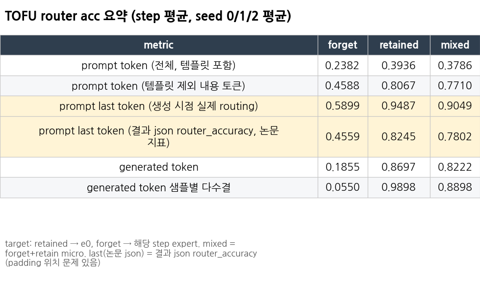
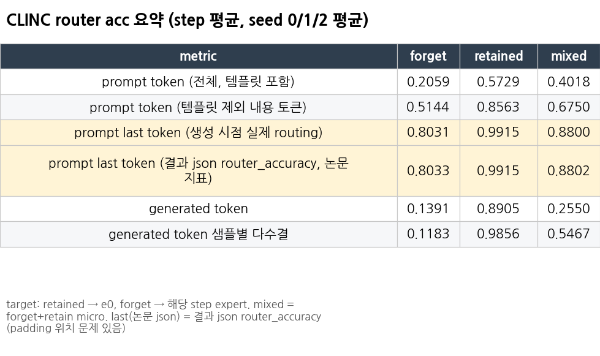
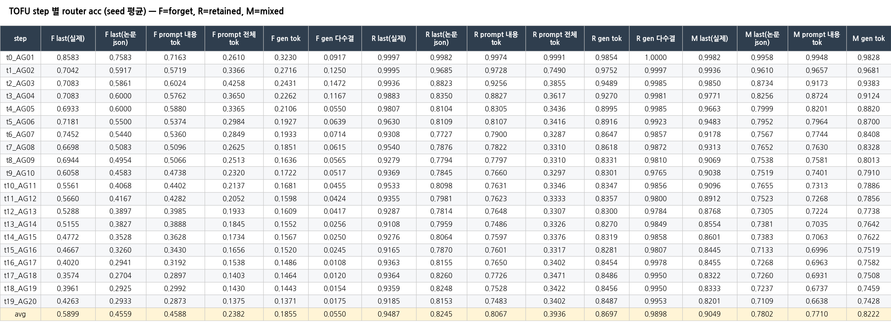
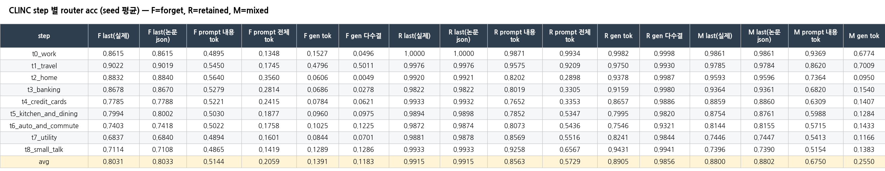
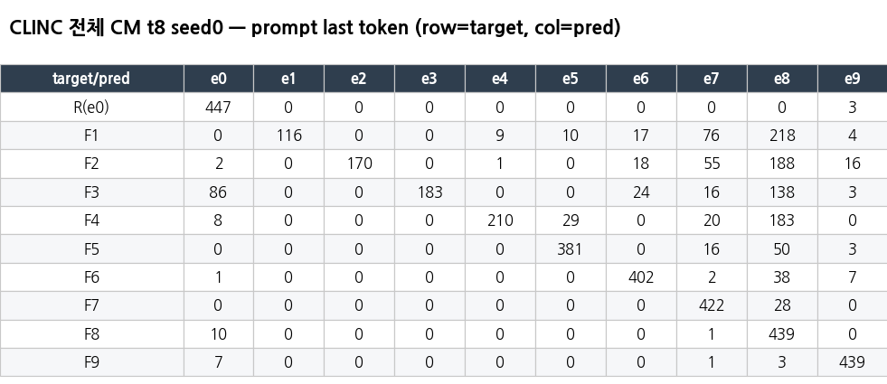
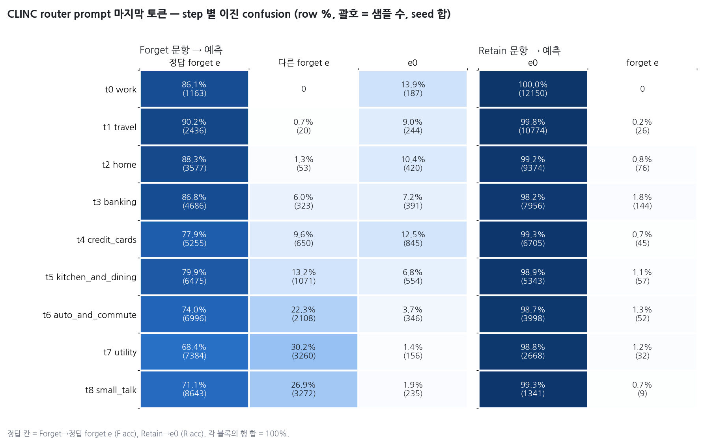
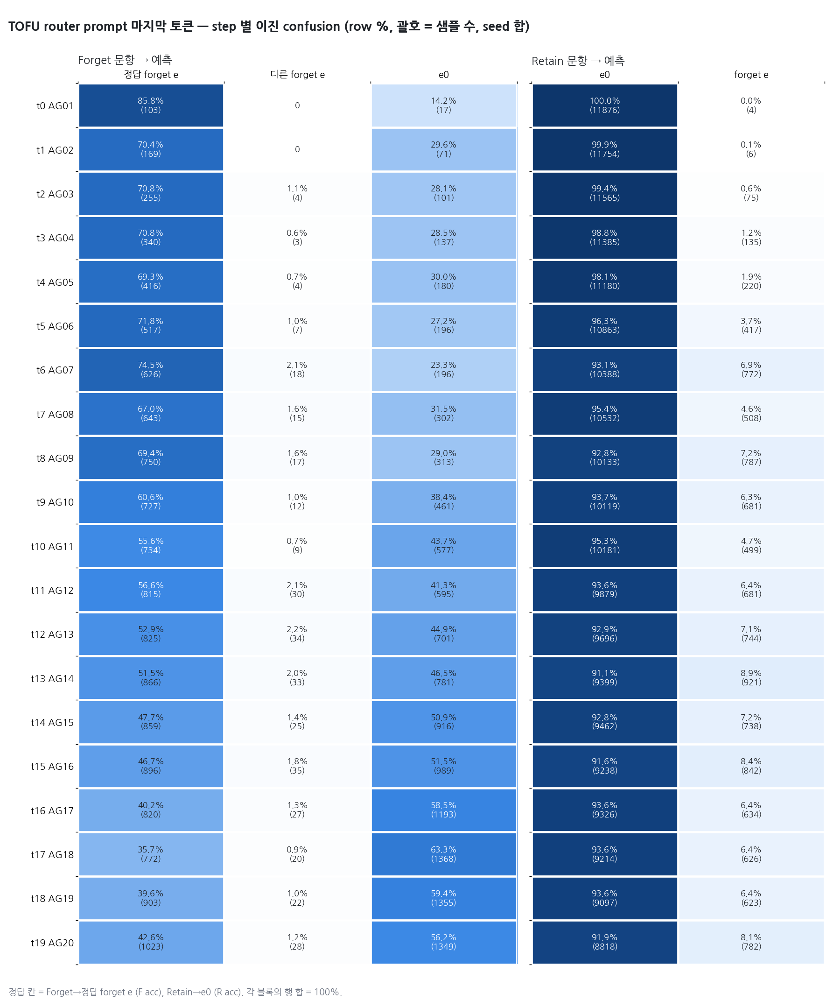
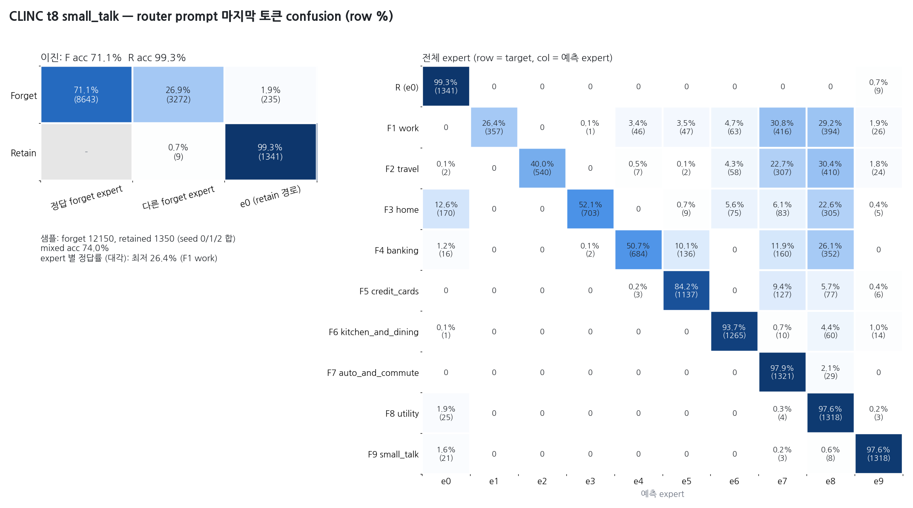

# Router acc (RULE, layer16 gate)

RULE의 router가 각 입력을 맞는 expert로 보내는지 세 가지 단위로 측정했습니다.
1. prompt 마지막 토큰 (논문 지표)
2. prompt 토큰 전체 / 템플릿을 뺀 내용 토큰
3. 생성 토큰

forget과 retain을 합친 confusion matrix도 같이 만들었습니다.

- 대상: TOFU t0–t19, CLINC t0–t8, **seed 0/1/2 전부** (TOFU `repro_tofu_lunar`, CLINC `repro_clinc_lunar_bs64` ckpt)
- target: retained → e0 (원래 모델 경로), forget → 그 step의 domain/author expert. mixed = forget+retain을 합친 micro 정확도
- 방법 (`code/router_token_eval.py`): 결과 json에 저장된 생성문을 **그대로 teacher forcing**하고 layer16 gate의 argmax를 기록 (재생성 안 함)
  - 검증: 실제 generate 중에 기록한 routing과 prompt 토큰 99.7%+, 생성 토큰 99.1%+ 일치. 재생성한 문장도 100% 동일
- 논문 지표 "last(논문 json)" = 결과 json의 `router_accuracy` (`compute_router_accuracy_BD`). 이 함수는 left-padding된 batch를 **position_ids 없이** forward해서, 실제 생성 시점의 routing과 다를 수 있습니다 (아래 2번)

## 1. 요약 (step 평균 → seed 평균)

| metric | TOFU forget | TOFU retained | TOFU mixed | CLINC forget | CLINC retained | CLINC mixed |
|---|---|---|---|---|---|---|
| prompt 전체 토큰 (템플릿 포함) | 0.238 | 0.394 | 0.379 | 0.206 | 0.573 | 0.402 |
| prompt 내용 토큰 (템플릿 제외) | 0.459 | 0.807 | 0.771 | 0.514 | 0.856 | 0.675 |
| **prompt 마지막 토큰 (생성 시점 실제)** | **0.590** | **0.949** | **0.905** | **0.803** | **0.992** | **0.880** |
| prompt 마지막 토큰 (결과 json, 논문 지표) | 0.456 | 0.825 | 0.780 | 0.803 | 0.992 | 0.880 |
| 생성 토큰 | 0.186 | 0.870 | 0.822 | 0.139 | 0.891 | 0.255 |
| 생성 토큰 샘플별 다수결 | 0.055 | 0.990 | 0.890 | 0.118 | 0.986 | 0.547 |

utility split (target = e0), step 평균 → seed 평균:

| metric | TOFU real_authors | TOFU world_facts | CLINC mrpc | CLINC rte |
|---|---|---|---|---|
| prompt 마지막 토큰 (실제) | 0.510 | 0.811 | 0.628 | 0.697 |
| prompt 마지막 토큰 (결과 json) | 0.767 | 0.737 | 0.627 | 0.696 |
| 생성 토큰 다수결 | 0.986 | 0.990 | 0.983 | 0.972 |

## 2. 분석

1. **TOFU는 논문 지표가 실제 routing보다 낮게 나옵니다 (padding 문제).** 결과 json의 router_accuracy는 forget 0.456 / retained 0.825이지만, 실제 생성할 때의 마지막 토큰 routing은 0.590 / 0.949입니다.
   - 원인: `compute_router_accuracy_BD`가 left-padded batch를 position_ids 없이 넣어서 RoPE 위치가 밀립니다.
   - CLINC는 프롬프트 길이가 비슷해서 padding이 거의 없고, 두 값이 같습니다 (99.6% 일치).
   - 그래서 router 성능을 보고할 때는 "실제" 열을 쓰는 것이 맞습니다.
2. **router는 사실상 마지막 토큰에서만 학습됐습니다.**
   - 템플릿 토큰은 대부분 e0이 아닌 expert로 갑니다 (전체 토큰 acc 0.2–0.6).
   - 내용 토큰만 봐도 forget 0.46–0.51 수준입니다.
3. **생성 토큰은 forget이어도 대부분 e0로 갑니다** (forget gen tok 0.14–0.19, 다수결 0.06–0.12).
   - retain은 생성 토큰도 e0 (다수결 0.99) → 원래 모델 그대로 답합니다.
   - forget은 마지막 prompt 토큰에서만 forget expert로 가고, 그 뒤 생성은 e0로 넘어갑니다. 즉 "거절/오답의 첫 토큰"이 정해진 뒤에는 원래 경로로 생성합니다.
   - 이 구조가 cross-input 실험(`../cross_domain`)에서 TOFU가 새는 이유와 연결됩니다.
4. **step이 늘수록 forget routing이 떨어집니다.**
   - TOFU 실제 last: t0 0.858 → t19 0.426. 틀린 문항은 주로 e0로 갑니다 (binary CM t19: F→맞는 e 1023, F→다른 forget e 28, F→e0 1349).
   - CLINC 실제 last: t0 0.862 → t8 0.711. 틀린 문항은 주로 **다른 forget expert**로 갑니다 (t8: F→맞는 e 8643, 다른 forget e 3272, e0 235). 그래서 "forget인지 아닌지"만 보면 CLINC는 98% 맞고, 실제 forget 성능도 유지됩니다 (forget acc 0.013).
   - TOFU는 F→e0 비율이 커져서, forget acc가 t19에 0.42까지 올라가는 것과 맞습니다.
5. retained는 TOFU 실제 last가 0.92–1.00으로 높습니다. utility는 TOFU real_authors 0.51, CLINC mrpc 0.63 / rte 0.70으로, utility 질문 일부가 forget expert로 갑니다.
   - 마지막 step 분포 (seed 합): CLINC mrpc 5,175문항 중 e0 1,227개, e8 2,889개. TOFU real_authors 300 중 e0 209개, e19 22개.

## 3. step별 표 / confusion matrix

- step별 통합표 (seed 평균, F/R/M × 지표): `tables/{tofu,clinc}_per_step_seedmean.{csv,png}`
  
  
- forget/retain 이진 CM (마지막 토큰 / 생성 토큰, seed 합): `tables/{ds}_binary_cm_{last,gen}.png`
- 전체 expert CM (마지막 step seed0): `tables/{ds}_full_cm_{last,gen}.png`
  
- utility 요약: `tables/{ds}_utility_summary.png`
- 원본 md에 있는 **모든 표**를 CSV로 변환한 파일 (seed별 값 포함): `tables/token_{ds}__*.csv`, `tables/last_token_{ds}__*.csv`

## 3-1. prompt 마지막 토큰 acc (%) + step별 색 confusion matrix (`last_png/`)

생성 시점의 실제 routing을 seed 0/1/2 합으로 집계했습니다 (`results/token_cm_csv/*_last.csv` 합산). 위 binary CM 표의 샘플 수와 같은 값입니다.

| 파일 | 내용 |
|---|---|
| `last_png/{clinc,tofu}_last_acc_pct.{csv,png}` | step별 F acc % (정답 expert), F→다른 forget e %, F→e0 %, R acc % (e0), R→forget e %, mixed %, 이진 F % |
| `last_png/{ds}_binary_cm_grid.png` | **한 격자**: 행 = step, 열 = Forget→(정답 forget e / 다른 forget e / e0) · Retain→(e0 / forget e), row %, 괄호 = 샘플 수 |
| `last_png/{ds}_binary_cm_all_steps.png` | 같은 내용을 step별 작은 CM으로 나눈 버전 |
| `last_png/{ds}_t{tt}_{domain}_cm.png` | step별: 이진 CM + 전체 expert CM (row %) |

| ds | F acc % (step 평균) | R acc % | mixed % | 이진 F % (아무 forget expert) |
|---|---|---|---|---|
| CLINC | 80.3 (t0 86.1 → t8 71.1) | 99.1 | 88.0 | 92.6 (t8 98.1) |
| TOFU | 59.0 (t0 85.8 → t19 42.6) | 94.9 | 90.5 | 60.2 (t19 43.8) |

- CLINC: 틀린 forget은 주로 **다른 forget expert**로 갑니다 (t8 26.9%, e0 1.9%).
  - 대부분 e7(utility) / e8(small_talk)로 몰립니다. t8 CM의 F1 work → e7 30.8%, e8 29.2%.
- TOFU: 틀린 forget은 거의 **e0**로 갑니다 (t19 56.2%, 다른 forget expert 1.2%).

## 4. 파일

| 경로 | 내용 |
|---|---|
| `results/token_{tofu,clinc}.md` | 토큰 단위 요약 원본 (모든 지표 × seed × step, CM, utility) |
| `results/last_token_{tofu,clinc}.{md,json}` | 저장된 router_info 기준 마지막 토큰 acc + CM (오프라인 분석) |
| `results/token/{ds}_s{0,1,2}/t*_{domain}.json/.npz`, `*_util.*` | step별 원시 결과 (토큰별 expert, 샘플별 지표) |
| `results/token_cm_csv/` | 모든 seed/step × {last, prompt_tok, prompt_content_tok, prompt_maj, gen_tok, gen_maj} CM (522개) |
| `results/cm_csv/` | 저장 router_info 기준 CM |
| `tables/` | 위를 정리한 CSV / PNG |
| `code/` | router_token_eval.py, summarize_router_token.py, router_last_token_cm.py, 실행 스크립트 |

원래 위치: `modify_code/repro_check/router_metrics/`. 다시 만들 때는 `python _build/build_all.py router`
